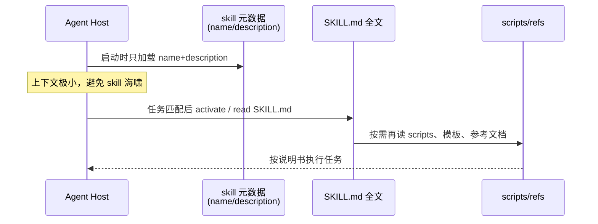
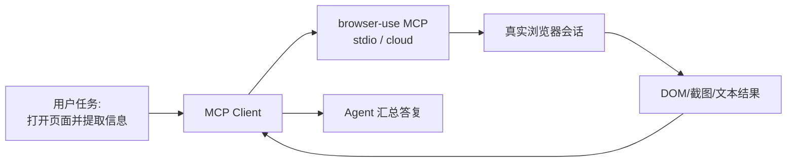
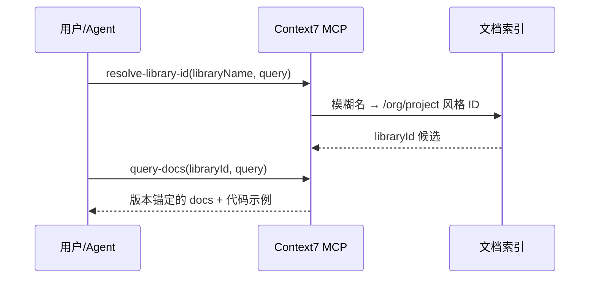

# 开源 AI Agent Skills / MCP 周报 · 第 1 期（2026-W43）

> **周期**：2026-10-18 → 2026-10-24（ISO 周次 W43）  
> **时区**：Asia/Shanghai（UTC+8）  
> **调研日**：2026-10-24  
> **范围**：完全开源、可二次开发（优先 MIT / Apache-2.0 / BSD）；覆盖 Agent Skills 标准与生态、Skills↔MCP 桥接、热门 MCP Server  
> **Star 来源**：本机无 `GH_TOKEN` 时用 GitHub 公开 API（`api.github.com/repos/...`）于 2026-10-24 拉取；文中标注为「已核实」。未拉到的写「未核实」。  
> **说明**：本期不创建 / 不推送 GitHub 仓库，仅本地 markdown 草稿。

---

## 本期速览

| 信号 | 内容 |
|------|------|
| 标准动向 | Anthropic 将 **Agent Skills** 捐赠给 Agentic AI Foundation（AAIF，Linux Foundation），与 MCP 同属中立基金会托管；规范仓库为 [`agentskills/agentskills`](https://github.com/agentskills/agentskills) |
| MCP × Skills | MCP 侧有 **SEP-2640 Skills Extension**（`skills/list`、`skills/get`、`skill://` 资源）；社区桥接如 Skilljack / Open-ClaudeSkill / skillsmcp 仍在用「工具式渐进披露」 |
| 实用分层 | **Skills** ≈ 可版本化的程序性知识；**MCP** ≈ 对外系统的实时工具调用。2026 实践共识：两者互补，而非互相替代 |
| 二次开发注意 | `anthropics/skills` **仓库级无 SPDX 许可证**；多数 skill 为 Apache-2.0，但 `docx`/`pdf`/`pptx`/`xlsx` 为 source-available（不可按开源二次开发） |

---

## 精选清单（按已核实 Stars 降序，共 12）

### 1. anthropics/skills

| 字段 | 内容 |
|------|------|
| **一句话** | Anthropic 官方示范 Agent Skills 合集（`SKILL.md` + 脚本/资源），是学习 Skills 形态的第一站 |
| **Stars** | **183,435**（已核实） |
| **许可证** | **仓库级无统一 SPDX**；多数 skill 目录为 **Apache-2.0**，文档类 skill（docx/pdf/pptx/xlsx）为 **source-available / 非开源**——二次开发请只拷贝带 Apache-2.0 `LICENSE.txt` 的 skill |
| **最新更新亮点** | 最近推送约 **2026-10-10 02:45 Asia/Shanghai**；近期含 `claude-api` skill 动态工作流与 quickstart 更新 |
| **仓库** | https://github.com/anthropics/skills |

### 2. browser-use/browser-use

| 字段 | 内容 |
|------|------|
| **一句话** | 开源 Python AI 浏览器 Agent 库，并提供本地 stdio MCP（`browser-use --mcp`）与云端 MCP 端点 |
| **Stars** | **119,026**（已核实） |
| **许可证** | **MIT** |
| **最新更新亮点** | 最近推送约 **2026-10-24 15:23 Asia/Shanghai**；持续维护 open-source + Cloud Agent API |
| **仓库** | https://github.com/browser-use/browser-use |

### 3. punkpeye/awesome-mcp-servers

| 字段 | 内容 |
|------|------|
| **一句话** | 社区最大 MCP Server 精选目录（按类别收录），二次开发前的「选型索引」 |
| **Stars** | **96,814**（已核实） |
| **许可证** | **MIT** |
| **最新更新亮点** | 最近推送约 **2026-10-24 02:57 Asia/Shanghai**；与 Glama 等目录联动 |
| **仓库** | https://github.com/punkpeye/awesome-mcp-servers |

### 4. modelcontextprotocol/servers

| 字段 | 内容 |
|------|------|
| **一句话** | MCP 官方参考 Server 合集（文件系统、Git、记忆、顺序思考等参考实现） |
| **Stars** | **91,541**（已核实） |
| **许可证** | GitHub 显示 **NOASSERTION**；文档称**新贡献 Apache-2.0**，存量部分仍为 **MIT**——分目录核对 LICENSE |
| **最新更新亮点** | 最近推送约 **2026-10-23 04:24 Asia/Shanghai**；部分早期参考 Server（如 Slack）已迁至 archived，选型时注意 README 指向 |
| **仓库** | https://github.com/modelcontextprotocol/servers |

### 5. upstash/context7

| 字段 | 内容 |
|------|------|
| **一句话** | 为编码 Agent 拉取**版本锚定**的库文档与示例；同时支持 **MCP** 与 **CLI + Skills** 两种接入 |
| **Stars** | **63,589**（已核实） |
| **许可证** | **MIT**（注意：本仓库主要是 MCP/CLI 客户端侧；爬取与后端为私有） |
| **最新更新亮点** | 最近推送约 **2026-10-23 21:48 Asia/Shanghai**；发布 **ctx7@0.8.2**、**@upstash/context7-sdk@0.6.0**（约 2026-10-23 19:23 Asia/Shanghai） |
| **仓库** | https://github.com/upstash/context7 |

### 6. ChromeDevTools/chrome-devtools-mcp

| 字段 | 内容 |
|------|------|
| **一句话** | 官方 Chrome DevTools MCP：让 Agent 控制/检视真实 Chrome（调试、性能、自动化） |
| **Stars** | **54,076**（已核实） |
| **许可证** | **Apache-2.0** |
| **最新更新亮点** | **v1.12.0**（约 2026-10-22 21:47 Asia/Shanghai）：`--watchConfig` 热重载、分层 ServerConfig、URL allow/block 热更新、heap snapshot 增强、工具并行执行等 |
| **仓库** | https://github.com/ChromeDevTools/chrome-devtools-mcp |

### 7. DeusData/codebase-memory-mcp

| 字段 | 内容 |
|------|------|
| **一句话** | 本地代码智能图：把代码/文档/基础设施连成持久图，经 MCP 暴露给 Agent，并支持变更感知测试选择 |
| **Stars** | **47,391**（已核实） |
| **许可证** | **MIT** |
| **最新更新亮点** | 最近推送约 **2026-10-24 13:45 Asia/Shanghai**；持续迭代 CBM Lens、MCP tools、agent 集成 |
| **仓库** | https://github.com/DeusData/codebase-memory-mcp |

### 8. microsoft/playwright-mcp

| 字段 | 内容 |
|------|------|
| **一句话** | Microsoft 官方 Playwright MCP：浏览器导航、点击、填表、截图等——社区高频「默认安装」之一 |
| **Stars** | **38,580**（已核实） |
| **许可证** | **Apache-2.0** |
| **最新更新亮点** | 最近推送约 **2026-10-23 01:43 Asia/Shanghai**；稳定版 **v0.0.83**（约 2026-09-29 07:17 Asia/Shanghai） |
| **仓库** | https://github.com/microsoft/playwright-mcp |

### 9. github/github-mcp-server

| 字段 | 内容 |
|------|------|
| **一句话** | GitHub 官方 MCP：Issues / PRs / Actions / 代码搜索等仓库操作一站接入 Agent |
| **Stars** | **33,919**（已核实） |
| **许可证** | **MIT** |
| **最新更新亮点** | **v2.0.3**（约 2026-10-21 17:52 Asia/Shanghai）：大文件 `get_file_contents` 改回资源链接、URI UTF-8 修复、`list_label` 游标分页、Go 1.27.3 等 |
| **仓库** | https://github.com/github/github-mcp-server |

### 10. yamadashy/repomix

| 字段 | 内容 |
|------|------|
| **一句话** | 把整个仓库打包成 AI 友好的单文件/结构化上下文，并支持 `repomix --mcp`（可加 `--sandbox`） |
| **Stars** | **29,007**（已核实） |
| **许可证** | **MIT** |
| **最新更新亮点** | 最近推送约 **2026-10-24 17:04 Asia/Shanghai**；MCP sandbox 路径约束持续完善 |
| **仓库** | https://github.com/yamadashy/repomix |

### 11. agentskills/agentskills

| 字段 | 内容 |
|------|------|
| **一句话** | **Agent Skills 开放标准**（规范 + 文档）：`SKILL.md` 格式、渐进披露、跨产品互操作的「规范源」 |
| **Stars** | **26,557**（已核实） |
| **许可证** | **Apache-2.0**（代码）；文档 **CC-BY-4.0** |
| **最新更新亮点** | 规范仓最近推送约 **2026-08-10 04:36 Asia/Shanghai**（相对偏静）；生态侧本周重点是 **捐赠 AAIF** 与 MCP Skills Extension 落地，而非频繁 commit |
| **仓库** | https://github.com/agentskills/agentskills · 站点 https://agentskills.io |

### 12. olaservo/skilljack-mcp

| 字段 | 内容 |
|------|------|
| **一句话** | 把本地 / 远程 Agent Skills「顶」进任意 MCP Client：`load-skill`、`skill://` 资源、HTTP/stdio，贴近官方 Skills Extension 思路 |
| **Stars** | **19**（已核实） |
| **许可证** | **MIT** |
| **最新更新亮点** | 最近推送约 **2026-10-21 19:42 Asia/Shanghai**；默认用 server instructions 下发 skill 目录（兼容 tool-search / deferred tools） |
| **仓库** | https://github.com/olaservo/skilljack-mcp |

#### 附：同赛道小而美（未进主榜，便于二次开发）

| 项目 | Stars（已核实） | 许可证 | 链接 |
|------|----------------|--------|------|
| QianjieTech/Open-ClaudeSkill（agentskill-mcp） | 47 | Apache-2.0 | https://github.com/QianjieTech/Open-ClaudeSkill |
| aviddiviner/skillsmcp | 27 | MIT | https://github.com/aviddiviner/skillsmcp |
| sohutv/agent-skills-mcp | 11 | Apache-2.0 | https://github.com/sohutv/agent-skills-mcp |
| mrsimpson/agentskills-mcp | 4 | MIT | https://github.com/mrsimpson/agentskills-mcp |

---

## Top 3 Demo 说明

> 对应榜单 **#1 / #2 / #5**（#3/#4 为目录/合集，交互 demo 价值较低；改用同属「单仓产品」且热度极高的 Context7）。  
> 静态页：`/workspace/skills-weekly/demo-01-agent-skills.html`、`demo-02-browser-use.html`、`demo-03-context7.html`。

### Demo 1 — Agent Skills 渐进披露（对应 #1 anthropics/skills / 规范 #11）

**核心流程（Mermaid）**



**二次开发要点**：实现「目录扫描 → 元数据索引 → 按需读全文」三层即可兼容 Claude Code / Cursor 等；不要在 initialize 时把所有 `SKILL.md` 塞进 system prompt。

### Demo 2 — browser-use MCP（对应 #2）

**核心流程**



**二次开发要点**：本地用 `uvx --from 'browser-use[cli]' browser-use --mcp`；云端走带 API Key 的 HTTP MCP。MCP 负责「手」，Skills 可另附「怎么测登录流」等规程。

### Demo 3 — Context7 文档注入（对应 #5）

**核心流程**



**二次开发要点**：先 `resolve-library-id` 再 `query-docs`；可与 Agent Skill（「写 Next.js 时必须先查 Context7」）组合，减少幻觉 API。

---

## 二次开发速查

| 目标 | 建议起点 | 许可证友好度 |
|------|----------|--------------|
| 实现 / 扩展 Skills 规范 | `agentskills/agentskills` | Apache-2.0 ✅ |
| 抄示范 skill（非文档编辑类） | `anthropics/skills` 中带 Apache-2.0 LICENSE 的目录 | 分目录核对 ⚠️ |
| Skills → 任意 MCP Client | `skilljack-mcp` / `Open-ClaudeSkill` / `skillsmcp` | MIT / Apache ✅ |
| 编码 Agent 默认三件套 | Context7 + GitHub MCP + Playwright MCP | MIT / MIT / Apache ✅ |
| 浏览器 Agent | browser-use 或 Playwright MCP | MIT / Apache ✅ |
| 仓库级上下文打包 | repomix `--mcp` | MIT ✅ |

### 最小 MCP 配置示例（示意）

```json
{
  "mcpServers": {
    "context7": {
      "command": "npx",
      "args": ["-y", "@upstash/context7-mcp"]
    },
    "github": {
      "command": "npx",
      "args": ["-y", "@modelcontextprotocol/server-github"],
      "env": { "GITHUB_PERSONAL_ACCESS_TOKEN": "YOUR_TOKEN" }
    },
    "playwright": {
      "command": "npx",
      "args": ["-y", "@playwright/mcp"]
    },
    "skilljack": {
      "command": "npx",
      "args": ["-y", "@skilljack/mcp", "/path/to/skills"]
    }
  }
}
```

---

## 数据与方法

1. **检索**：WebSearch（Agent Skills / MCP / awesome 列表 / ProtocolProbe 排行）+ GitHub REST API（无 token，公开速率限制内）。  
2. **未使用**：`gh` CLI（box 上未登录且无 `GH_TOKEN`）。  
3. **时间**：API 的 `pushed_at` / `published_at` 为 UTC，文中已换算为 **Asia/Shanghai**。  
4. **不做的事**：不伪造 star；不创建远程仓库；不对未开源/混合许可部分做「可自由二次开发」承诺。

---

## 下期预告（草稿备忘）

- 跟踪 MCP **Skills Extension（SEP-2640）** 各 SDK（TS/Python/C#）落地进度  
- 对比 Skilljack vs Open-ClaudeSkill vs 官方 `skills/*` 方法面差异  
- 增补 GitLab / Forgejo MCP、数据库类 MCP（googleapis/genai-toolbox 等）许可与活跃度

---

*第 1 期完 · 文件路径：`/workspace/skills-weekly/2026-W43-open-source-skills.md`*
