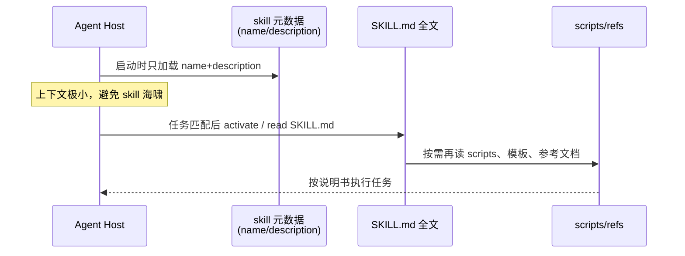
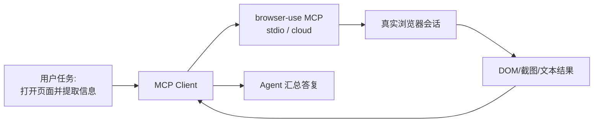
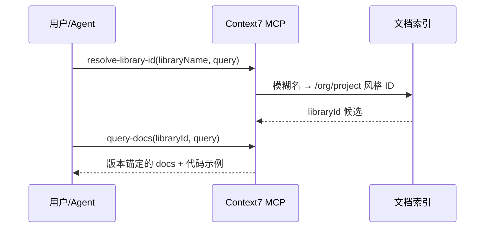

# 开源 AI Agent Skills / MCP 周报 · 第 2 期（2026-W44）

> **周期**：2026-10-25 → 2026-10-31（ISO 周次 W44）  
> **时区**：Asia/Shanghai（UTC+8）  
> **调研日**：2026-10-26  
> **范围**：完全开源、可二次开发（优先 MIT / Apache-2.0 / BSD）；覆盖 Agent Skills 标准与生态、Skills↔MCP 桥接、热门 MCP Server  
> **Star 来源**：cursor-github `get_repository` / `search_repositories`（连接账户 gaojiang818）于 **2026-10-26** 拉取；文中标注为「已核实」。  
> **相对上期**：对比 [`reports/2026-W43-open-source-skills.md`](./2026-W43-open-source-skills.md)（调研日 2026-10-24）已核实 Stars。

---

## 本期速览

| 信号 | 内容 |
|------|------|
| 相对 W43 | 主榜前 11 名次未变；合计约 **+890 stars**（2 日窗口，增量温和）。本周 **周一例行出刊**，以复核数字 + 新晋项目为主 |
| 新晋高星 | **NVIDIA/SkillSpector**（Apache-2.0，**21,604**）进入主榜 #12：Agent Skills / MCP skill 安装前安全扫描；**yusufkaraaslan/Skill_Seekers**（MIT，**15,220**）列入「小而美/新晋」——文档站/仓库→Claude Skill |
| 活跃推送（W44 初） | `DeusData/codebase-memory-mcp`、`modelcontextprotocol/servers`、`yamadashy/repomix`、`ChromeDevTools/chrome-devtools-mcp`、`olaservo/skilljack-mcp` 在 10-25～10-26（Asia/Shanghai）有推送 |
| 二次开发注意 | `anthropics/skills` **仓库级仍无 SPDX**；文档类 skill（docx/pdf/pptx/xlsx）为 source-available，**不可**当开源二次开发；`modelcontextprotocol/servers` 为 NOASSERTION（新贡献 Apache-2.0 / 存量部分 MIT，分目录核对） |

### 相对 W43 · Stars 差异表（已核实）

| 项目 | W43 | W44 | Δ |
|------|-----|-----|---|
| anthropics/skills | 183,435 | **183,763** | +328 |
| browser-use/browser-use | 119,026 | **119,126** | +100 |
| punkpeye/awesome-mcp-servers | 96,814 | **96,868** | +54 |
| modelcontextprotocol/servers | 91,541 | **91,560** | +19 |
| upstash/context7 | 63,589 | **63,675** | +86 |
| ChromeDevTools/chrome-devtools-mcp | 54,076 | **54,142** | +66 |
| DeusData/codebase-memory-mcp | 47,391 | **47,473** | +82 |
| microsoft/playwright-mcp | 38,580 | **38,631** | +51 |
| github/github-mcp-server | 33,919 | **33,947** | +28 |
| yamadashy/repomix | 29,007 | **29,023** | +16 |
| agentskills/agentskills | 26,557 | **26,617** | +60 |
| olaservo/skilljack-mcp（上期 #12） | 19 | **19** | 0 |
| **NVIDIA/SkillSpector（本期新晋主榜）** | — | **21,604** | 新入榜 |

> 说明：W43→W44 调研间隔约 2 天；Δ 为短窗变化，不作趋势外推。Skilljack 仍活跃（最近推送约 2026-10-25 07:43 Asia/Shanghai），因星数远低于新晋高星项目，本期改列附录桥接组。

---

## 精选清单（按已核实 Stars 降序，共 12）

### 1. anthropics/skills

| 字段 | 内容 |
|------|------|
| **一句话** | Anthropic 官方示范 Agent Skills 合集（`SKILL.md` + 脚本/资源），是学习 Skills 形态的第一站 |
| **Stars** | **183,763**（已核实） |
| **许可证** | **仓库级无统一 SPDX**；多数 skill 目录为 **Apache-2.0**，文档类 skill（docx/pdf/pptx/xlsx）为 **source-available / 非开源**——二次开发请只拷贝带 Apache-2.0 `LICENSE.txt` 的 skill |
| **最新更新亮点** | 最近推送约 **2026-10-10 02:45 Asia/Shanghai**（相对本周无新推送）；星数仍居生态第一 |
| **仓库** | https://github.com/anthropics/skills |

### 2. browser-use/browser-use

| 字段 | 内容 |
|------|------|
| **一句话** | 开源 Python AI 浏览器 Agent 库，并提供本地 stdio MCP（`browser-use --mcp`）与云端 MCP 端点 |
| **Stars** | **119,126**（已核实） |
| **许可证** | **MIT** |
| **最新更新亮点** | 最近推送约 **2026-10-24 15:23 Asia/Shanghai**；持续维护 open-source + Cloud Agent API |
| **仓库** | https://github.com/browser-use/browser-use |

### 3. punkpeye/awesome-mcp-servers

| 字段 | 内容 |
|------|------|
| **一句话** | 社区最大 MCP Server 精选目录（按类别收录），二次开发前的「选型索引」 |
| **Stars** | **96,868**（已核实） |
| **许可证** | **MIT** |
| **最新更新亮点** | 最近推送约 **2026-10-24 02:57 Asia/Shanghai**；与 Glama 等目录联动 |
| **仓库** | https://github.com/punkpeye/awesome-mcp-servers |

### 4. modelcontextprotocol/servers

| 字段 | 内容 |
|------|------|
| **一句话** | MCP 官方参考 Server 合集（文件系统、Git、记忆、顺序思考等参考实现） |
| **Stars** | **91,560**（已核实） |
| **许可证** | GitHub 显示 **NOASSERTION**；文档称**新贡献 Apache-2.0**，存量部分仍为 **MIT**——分目录核对 LICENSE |
| **最新更新亮点** | 最近推送约 **2026-10-25 13:26 Asia/Shanghai**；选型时注意 README 对已迁出/归档 Server 的指向 |
| **仓库** | https://github.com/modelcontextprotocol/servers |

### 5. upstash/context7

| 字段 | 内容 |
|------|------|
| **一句话** | 为编码 Agent 拉取**版本锚定**的库文档与示例；同时支持 **MCP** 与 **CLI + Skills** 两种接入 |
| **Stars** | **63,675**（已核实） |
| **许可证** | **MIT**（注意：本仓库主要是 MCP/CLI 客户端侧；爬取与后端为私有） |
| **最新更新亮点** | 最近推送约 **2026-10-23 21:48 Asia/Shanghai**；最新可见发布 **@upstash/context7-sdk@0.6.0**（约 2026-10-23 19:23 Asia/Shanghai）：`search()` 结果增加 snippet `rank` |
| **仓库** | https://github.com/upstash/context7 |

### 6. ChromeDevTools/chrome-devtools-mcp

| 字段 | 内容 |
|------|------|
| **一句话** | 官方 Chrome DevTools MCP：让 Agent 控制/检视真实 Chrome（调试、性能、自动化） |
| **Stars** | **54,142**（已核实） |
| **许可证** | **Apache-2.0** |
| **最新更新亮点** | 稳定版仍为 **v1.12.0**（发布约 **2026-10-22 21:47 Asia/Shanghai**）；仓库最近推送约 **2026-10-25 08:06 Asia/Shanghai**（含 WebAuthn 虚拟认证器等后续 commit） |
| **仓库** | https://github.com/ChromeDevTools/chrome-devtools-mcp |

### 7. DeusData/codebase-memory-mcp

| 字段 | 内容 |
|------|------|
| **一句话** | 本地代码智能图：把代码/文档/基础设施连成持久图，经 MCP 暴露给 Agent，并支持变更感知测试选择 |
| **Stars** | **47,473**（已核实） |
| **许可证** | **MIT** |
| **最新更新亮点** | 最近推送约 **2026-10-26 08:58 Asia/Shanghai**（调研当日仍有更新）；持续迭代 CBM Lens、MCP tools、agent 集成 |
| **仓库** | https://github.com/DeusData/codebase-memory-mcp |

### 8. microsoft/playwright-mcp

| 字段 | 内容 |
|------|------|
| **一句话** | Microsoft 官方 Playwright MCP：浏览器导航、点击、填表、截图等——社区高频「默认安装」之一 |
| **Stars** | **38,631**（已核实） |
| **许可证** | **Apache-2.0** |
| **最新更新亮点** | 最近推送约 **2026-10-23 01:43 Asia/Shanghai** |
| **仓库** | https://github.com/microsoft/playwright-mcp |

### 9. github/github-mcp-server

| 字段 | 内容 |
|------|------|
| **一句话** | GitHub 官方 MCP：Issues / PRs / Actions / 代码搜索等仓库操作一站接入 Agent |
| **Stars** | **33,947**（已核实） |
| **许可证** | **MIT** |
| **最新更新亮点** | 最新发布仍为 **v2.0.3**（约 **2026-10-21 17:52 Asia/Shanghai**）；最近推送约 **2026-10-24 05:21 Asia/Shanghai** |
| **仓库** | https://github.com/github/github-mcp-server |

### 10. yamadashy/repomix

| 字段 | 内容 |
|------|------|
| **一句话** | 把整个仓库打包成 AI 友好的单文件/结构化上下文，并支持 `repomix --mcp`（可加 `--sandbox`） |
| **Stars** | **29,023**（已核实） |
| **许可证** | **MIT** |
| **最新更新亮点** | 最近推送约 **2026-10-25 23:48 Asia/Shanghai**；MCP sandbox 路径约束持续完善 |
| **仓库** | https://github.com/yamadashy/repomix |

### 11. agentskills/agentskills

| 字段 | 内容 |
|------|------|
| **一句话** | **Agent Skills 开放标准**（规范 + 文档）：`SKILL.md` 格式、渐进披露、跨产品互操作的「规范源」 |
| **Stars** | **26,617**（已核实） |
| **许可证** | **Apache-2.0**（代码）；文档 **CC-BY-4.0** |
| **最新更新亮点** | 规范仓最近推送约 **2026-08-10 04:36 Asia/Shanghai**（相对偏静）；星数继续缓增 |
| **仓库** | https://github.com/agentskills/agentskills · 站点 https://agentskills.io |

### 12. NVIDIA/SkillSpector（本期新晋）

| 字段 | 内容 |
|------|------|
| **一句话** | Agent Skills 安全扫描器：安装前检测恶意模式、提示注入、数据外泄与供应链风险（支持 Claude Code / Codex / MCP skills） |
| **Stars** | **21,604**（已核实） |
| **许可证** | **Apache-2.0** |
| **最新更新亮点** | 最近推送约 **2026-10-23 17:40 Asia/Shanghai**；文档站 https://docs.nvidia.com/skills/scanning-agent-skills |
| **仓库** | https://github.com/NVIDIA/SkillSpector |

#### 附：同赛道小而美 / 桥接 / 本周关注（未进主榜）

| 项目 | Stars（已核实） | 许可证 | 备注 | 链接 |
|------|----------------|--------|------|------|
| yusufkaraaslan/Skill_Seekers | 15,220 | MIT | 文档站/GitHub/PDF → Claude Skill；含 MCP | https://github.com/yusufkaraaslan/Skill_Seekers |
| QianjieTech/Open-ClaudeSkill | 47 | Apache-2.0 | Skills→任意 MCP Client | https://github.com/QianjieTech/Open-ClaudeSkill |
| aviddiviner/skillsmcp | 27 | MIT | Skills MCP 暴露 | https://github.com/aviddiviner/skillsmcp |
| olaservo/skilljack-mcp | 19 | MIT | 上期主榜；本周仍有推送（约 10-25 07:43） | https://github.com/olaservo/skilljack-mcp |
| sohutv/agent-skills-mcp | 11 | Apache-2.0 | 规范对齐的 Skills MCP | https://github.com/sohutv/agent-skills-mcp |

> 检索备忘：`topic:mcp-server` 与宽泛 `"claude skills"` 搜索会混入 n8n、awesome 列表等非本刊范围项目；本刊只保留可二次开发的 Skills/MCP 相关仓，并逐仓 `get_repository` 核实 Stars 与许可证。`oraios/serena` 等热度高但 SPDX 为 NOASSERTION，本期不进主榜。

---

## Top 3 Demo 说明

> 对应榜单 **#1 / #2 / #5**（#3/#4 为目录/合集，交互 demo 价值较低；改用同属「单仓产品」且热度极高的 Context7）。  
> Top3 与 W43 相同，故**更新既有静态页 footer 为 W44**并微调文案：`demos/demo-01-agent-skills.html`、`demo-02-browser-use.html`、`demo-03-context7.html`。

### Demo 1 — Agent Skills 渐进披露（对应 #1 anthropics/skills / 规范 #11）

**核心流程（Mermaid）**



**二次开发要点**：实现「目录扫描 → 元数据索引 → 按需读全文」三层即可兼容 Claude Code / Cursor 等；不要在 initialize 时把所有 `SKILL.md` 塞进 system prompt。安装第三方 skill 前可先过 SkillSpector 一类扫描。

### Demo 2 — browser-use MCP（对应 #2）

**核心流程**



**二次开发要点**：本地用 `uvx --from 'browser-use[cli]' browser-use --mcp`；云端走带 API Key 的 HTTP MCP。MCP 负责「手」，Skills 可另附「怎么测登录流」等规程。

### Demo 3 — Context7 文档注入（对应 #5）

**核心流程**



**二次开发要点**：先 `resolve-library-id` 再 `query-docs`；可与 Agent Skill（「写 Next.js 时必须先查 Context7」）组合，减少幻觉 API。SDK 0.6.0 起注意 snippet `rank` 字段。

---

## 二次开发速查

| 目标 | 建议起点 | 许可证友好度 |
|------|----------|--------------|
| 实现 / 扩展 Skills 规范 | `agentskills/agentskills` | Apache-2.0 ✅ |
| 抄示范 skill（非文档编辑类） | `anthropics/skills` 中带 Apache-2.0 LICENSE 的目录 | 分目录核对 ⚠️ |
| 安装前扫描第三方 skill | `NVIDIA/SkillSpector` | Apache-2.0 ✅ |
| 文档→Skill 生成 | `Skill_Seekers` | MIT ✅ |
| Skills → 任意 MCP Client | `skilljack-mcp` / `Open-ClaudeSkill` / `skillsmcp` | MIT / Apache ✅ |
| 编码 Agent 默认三件套 | Context7 + GitHub MCP + Playwright MCP | MIT / MIT / Apache ✅ |
| 浏览器 Agent | browser-use 或 Playwright MCP | MIT / Apache ✅ |
| 仓库级上下文打包 | repomix `--mcp` | MIT ✅ |

### 最小 MCP 配置示例（示意）

```json
{
  "mcpServers": {
    "context7": {
      "command": "npx",
      "args": ["-y", "@upstash/context7-mcp"]
    },
    "github": {
      "command": "npx",
      "args": ["-y", "@modelcontextprotocol/server-github"],
      "env": { "GITHUB_PERSONAL_ACCESS_TOKEN": "YOUR_TOKEN" }
    },
    "playwright": {
      "command": "npx",
      "args": ["-y", "@playwright/mcp"]
    },
    "skilljack": {
      "command": "npx",
      "args": ["-y", "@skilljack/mcp", "/path/to/skills"]
    }
  }
}
```

---

## 数据与方法

1. **检索**：cursor-github `search_repositories`（`topic:mcp-server`、`claude skills` / `agent skills`、`Skill_Seekers` / `claude-skills-mcp` / `agentskills` 等）+ 对候选仓逐一 `get_repository` 核实 `stargazers_count`、`license.spdx_id`、`pushed_at`；部分仓辅以 `get_latest_release` / `list_commits`。  
2. **本机 `gh`**：box 上 `gh auth status` 显示未登录；调研走 MCP 鉴权账户（`get_me` → gaojiang818）。推送见仓库 commit。  
3. **时间**：API 的 `pushed_at` / `published_at` 为 UTC，文中已换算为 **Asia/Shanghai**。  
4. **不做的事**：不伪造 star；不对未开源/混合许可部分做「可自由二次开发」承诺；文档类 skill 不按开源二次开发推荐。

---

## 下期预告

- 继续跟踪 MCP **Skills Extension（SEP-2640）** 各 SDK 落地  
- SkillSpector 扫描规则与社区桥接（Skilljack / Open-ClaudeSkill）对比  
- 关注 `oraios/serena` 等若补齐清晰 SPDX 再评估入榜

---

*第 2 期完 · 2026-W44*
