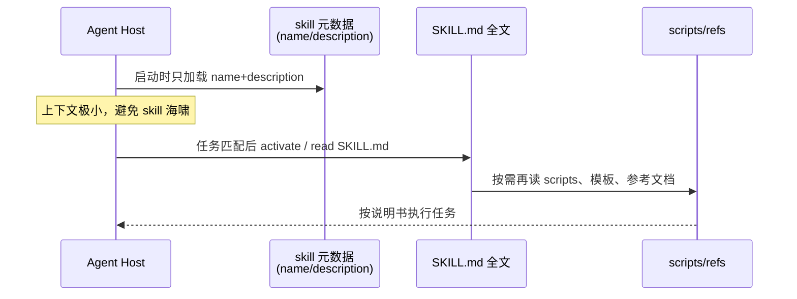
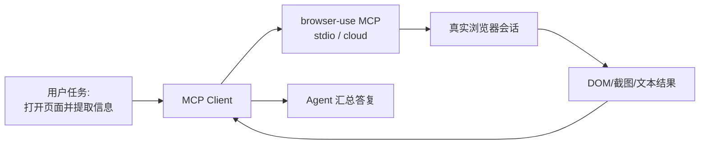
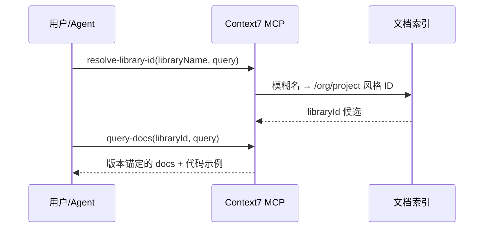

# 开源 AI Agent Skills / MCP 周报 · 第 3 期（2026-W45）

> **周期**：2026-11-01 → 2026-11-07（ISO 周次 W45）  
> **时区**：Asia/Shanghai（UTC+8）  
> **调研日**：2026-11-02  
> **范围**：完全开源、可二次开发（优先 MIT / Apache-2.0 / BSD）；覆盖 Agent Skills 标准与生态、Skills↔MCP 桥接、热门 MCP Server  
> **Star 来源**：cursor-github `get_repository` / `search_repositories`（连接账户 gaojiang818）于 **2026-11-02** 拉取；文中标注为「已核实」。  
> **相对上期**：对比 [`reports/2026-W44-open-source-skills.md`](./2026-W44-open-source-skills.md)（调研日 2026-10-26）已核实 Stars。

---

## 本期速览

| 信号 | 内容 |
|------|------|
| 相对 W44 | 主榜 **12 名次未变**；合计约 **+8,180 stars**（约 7 日短窗）。`anthropics/skills`（**+2,607**）与 `NVIDIA/SkillSpector`（**+2,263**）领涨；其余多为三位数缓增 |
| 新晋入主榜？ | **无**。检索到大量「病毒式」单仓 Skill / Agent harness（如 ECC、hermes-agent、ui-ux-pro-max-skill、graphify、caveman 等），星数极高但**不纳入主榜**——本刊坚持基础设施 / 标准 / MCP Server / Skills↔MCP 桥接口径，并对异常星数保持怀疑 |
| 活跃推送（W45 初） | `anthropics/skills`（mcp-builder 教 MCP TS SDK v2）、`NVIDIA/SkillSpector`（YARA / CLI 修复）、`upstash/context7`（MCP research preview + docs feedback）、`microsoft/playwright-mcp`（**v0.0.84**）、`DeusData/codebase-memory-mcp`、`ChromeDevTools/chrome-devtools-mcp`、`olaservo/skilljack-mcp` 等有更新 |
| 二次开发注意 | `anthropics/skills` **仓库级仍无 SPDX**；文档类 skill（docx/pdf/pptx/xlsx）为 source-available，**不可**当开源二次开发；`modelcontextprotocol/servers` 仍为 NOASSERTION |

### 相对 W44 · Stars 差异表（已核实）

| 项目 | W44 | W45 | Δ |
|------|-----|-----|---|
| anthropics/skills | 183,763 | **186,370** | +2,607 |
| browser-use/browser-use | 119,126 | **119,772** | +646 |
| punkpeye/awesome-mcp-servers | 96,868 | **97,175** | +307 |
| modelcontextprotocol/servers | 91,560 | **91,738** | +178 |
| upstash/context7 | 63,675 | **64,051** | +376 |
| ChromeDevTools/chrome-devtools-mcp | 54,142 | **54,624** | +482 |
| DeusData/codebase-memory-mcp | 47,473 | **47,956** | +483 |
| microsoft/playwright-mcp | 38,631 | **38,951** | +320 |
| github/github-mcp-server | 33,947 | **34,143** | +196 |
| yamadashy/repomix | 29,023 | **29,111** | +88 |
| agentskills/agentskills | 26,617 | **26,851** | +234 |
| NVIDIA/SkillSpector | 21,604 | **23,867** | +2,263 |

> 说明：W44→W45 调研间隔约 7 天；Δ 为短窗变化，不作趋势外推。主榜连续性优先：本周无「基础设施级」新晋达到 SkillSpector 式入榜标准。

---

## 精选清单（按已核实 Stars 降序，共 12）

### 1. anthropics/skills

| 字段 | 内容 |
|------|------|
| **一句话** | Anthropic 官方示范 Agent Skills 合集（`SKILL.md` + 脚本/资源），是学习 Skills 形态的第一站 |
| **Stars** | **186,370**（已核实） |
| **许可证** | **仓库级无统一 SPDX**；多数 skill 目录为 **Apache-2.0**，文档类 skill（docx/pdf/pptx/xlsx）为 **source-available / 非开源**——二次开发请只拷贝带 Apache-2.0 `LICENSE.txt` 的 skill |
| **最新更新亮点** | 最近推送约 **2026-10-29 03:20 Asia/Shanghai**：`mcp-builder` skill 更新，教 **MCP TypeScript SDK v2**（`@modelcontextprotocol/server`）选型、stdio/HTTP 示例与自检脚本；本周短窗星数 **+2,607** |
| **仓库** | https://github.com/anthropics/skills |

### 2. browser-use/browser-use

| 字段 | 内容 |
|------|------|
| **一句话** | 开源 Python AI 浏览器 Agent 库，并提供本地 stdio MCP（`browser-use --mcp`）与云端 MCP 端点 |
| **Stars** | **119,772**（已核实） |
| **许可证** | **MIT** |
| **最新更新亮点** | 最近推送约 **2026-10-31 09:18 Asia/Shanghai**；持续维护 open-source + Cloud Agent API |
| **仓库** | https://github.com/browser-use/browser-use |

### 3. punkpeye/awesome-mcp-servers

| 字段 | 内容 |
|------|------|
| **一句话** | 社区最大 MCP Server 精选目录（按类别收录），二次开发前的「选型索引」 |
| **Stars** | **97,175**（已核实） |
| **许可证** | **MIT** |
| **最新更新亮点** | 最近推送约 **2026-10-24 02:57 Asia/Shanghai**（相对本周无新推送）；与 Glama 等目录联动 |
| **仓库** | https://github.com/punkpeye/awesome-mcp-servers |

### 4. modelcontextprotocol/servers

| 字段 | 内容 |
|------|------|
| **一句话** | MCP 官方参考 Server 合集（文件系统、Git、记忆、顺序思考等参考实现） |
| **Stars** | **91,738**（已核实） |
| **许可证** | GitHub 显示 **NOASSERTION**；文档称**新贡献 Apache-2.0**，存量部分仍为 **MIT**——分目录核对 LICENSE |
| **最新更新亮点** | 最近推送约 **2026-10-29 13:27 Asia/Shanghai**；选型时注意 README 对已迁出/归档 Server 的指向 |
| **仓库** | https://github.com/modelcontextprotocol/servers |

### 5. upstash/context7

| 字段 | 内容 |
|------|------|
| **一句话** | 为编码 Agent 拉取**版本锚定**的库文档与示例；同时支持 **MCP** 与 **CLI + Skills** 两种接入 |
| **Stars** | **64,051**（已核实） |
| **许可证** | **MIT**（注意：本仓库主要是 MCP/CLI 客户端侧；爬取与后端为私有） |
| **最新更新亮点** | 最近推送约 **2026-11-01 18:36 Asia/Shanghai**；本周可见：MCP **research preview** 开关、docs feedback 工具、未设置 `${CONTEXT7_API_KEY}` 占位符按无 Key 处理 |
| **仓库** | https://github.com/upstash/context7 |

### 6. ChromeDevTools/chrome-devtools-mcp

| 字段 | 内容 |
|------|------|
| **一句话** | 官方 Chrome DevTools MCP：让 Agent 控制/检视真实 Chrome（调试、性能、自动化） |
| **Stars** | **54,624**（已核实） |
| **许可证** | **Apache-2.0** |
| **最新更新亮点** | 稳定版仍为 **v1.12.0**（发布约 **2026-10-22 21:47 Asia/Shanghai**）；仓库最近推送约 **2026-11-01 09:10 Asia/Shanghai**（含 viewport 整数校验、Lighthouse 13.6.0 等后续 commit） |
| **仓库** | https://github.com/ChromeDevTools/chrome-devtools-mcp |

### 7. DeusData/codebase-memory-mcp

| 字段 | 内容 |
|------|------|
| **一句话** | 本地代码智能图：把代码/文档/基础设施连成持久图，经 MCP 暴露给 Agent，并支持变更感知测试选择 |
| **Stars** | **47,956**（已核实） |
| **许可证** | **MIT** |
| **最新更新亮点** | 最近推送约 **2026-11-02 08:44 Asia/Shanghai**（调研当日仍有更新）；持续迭代文档与依赖 |
| **仓库** | https://github.com/DeusData/codebase-memory-mcp |

### 8. microsoft/playwright-mcp

| 字段 | 内容 |
|------|------|
| **一句话** | Microsoft 官方 Playwright MCP：浏览器导航、点击、填表、截图等——社区高频「默认安装」之一 |
| **Stars** | **38,951**（已核实） |
| **许可证** | **Apache-2.0** |
| **最新更新亮点** | 最新发布 **v0.0.84**（约 **2026-10-31 23:20 Asia/Shanghai**）：同浏览器多隔离会话、`redactUrlParams`、`browser_find.maxResults`、跨导航网络请求历史、多语言 locator 等；仓库最近推送约 **2026-11-02 07:12 Asia/Shanghai** |
| **仓库** | https://github.com/microsoft/playwright-mcp |

### 9. github/github-mcp-server

| 字段 | 内容 |
|------|------|
| **一句话** | GitHub 官方 MCP：Issues / PRs / Actions / 代码搜索等仓库操作一站接入 Agent |
| **Stars** | **34,143**（已核实） |
| **许可证** | **MIT** |
| **最新更新亮点** | 最新发布仍为 **v2.0.3**（约 **2026-10-21 17:52 Asia/Shanghai**）；最近推送约 **2026-10-31 04:23 Asia/Shanghai** |
| **仓库** | https://github.com/github/github-mcp-server |

### 10. yamadashy/repomix

| 字段 | 内容 |
|------|------|
| **一句话** | 把整个仓库打包成 AI 友好的单文件/结构化上下文，并支持 `repomix --mcp`（可加 `--sandbox`） |
| **Stars** | **29,111**（已核实） |
| **许可证** | **MIT** |
| **最新更新亮点** | 最近推送约 **2026-11-02 00:12 Asia/Shanghai**；MCP sandbox 路径约束持续完善 |
| **仓库** | https://github.com/yamadashy/repomix |

### 11. agentskills/agentskills

| 字段 | 内容 |
|------|------|
| **一句话** | **Agent Skills 开放标准**（规范 + 文档）：`SKILL.md` 格式、渐进披露、跨产品互操作的「规范源」 |
| **Stars** | **26,851**（已核实） |
| **许可证** | **Apache-2.0**（代码）；文档 **CC-BY-4.0** |
| **最新更新亮点** | 规范仓最近推送约 **2026-08-10 04:36 Asia/Shanghai**（相对偏静）；星数继续缓增（+234） |
| **仓库** | https://github.com/agentskills/agentskills · 站点 https://agentskills.io |

### 12. NVIDIA/SkillSpector

| 字段 | 内容 |
|------|------|
| **一句话** | Agent Skills 安全扫描器：安装前检测恶意模式、提示注入、数据外泄与供应链风险（支持 Claude Code / Codex / MCP skills） |
| **Stars** | **23,867**（已核实） |
| **许可证** | **Apache-2.0** |
| **最新更新亮点** | 最近推送约 **2026-11-01 03:10 Asia/Shanghai**；本周可见：YARA `info_stealer` 规则收紧（减少文档误报）、CLI 在扫描前拒绝目录型 `--output`；短窗星数 **+2,263** |
| **仓库** | https://github.com/NVIDIA/SkillSpector · 文档 https://docs.nvidia.com/skills/scanning-agent-skills |

#### 附：同赛道小而美 / 桥接 / 本周关注（未进主榜）

| 项目 | Stars（已核实） | 许可证 | 备注 | 链接 |
|------|----------------|--------|------|------|
| yusufkaraaslan/Skill_Seekers | 15,263 | MIT | 文档站/GitHub/PDF → Claude Skill；含 MCP；Δ≈+43 | https://github.com/yusufkaraaslan/Skill_Seekers |
| mcp-use/mcp-use | 10,837 | MIT | 全栈 MCP 框架（Apps / Servers / Client） | https://github.com/mcp-use/mcp-use |
| mobile-next/mobile-mcp | 10,202 | Apache-2.0 | 移动端（iOS/Android）MCP | https://github.com/mobile-next/mobile-mcp |
| awslabs/mcp | 9,860 | Apache-2.0 | AWS 官方开源 MCP Servers 合集 | https://github.com/awslabs/mcp |
| Ryze-AI-Adgent/open-seo-mcp-skills | 8,556 | MIT | SEO MCP + Skills（垂直场景） | https://github.com/Ryze-AI-Adgent/open-seo-mcp-skills |
| firecrawl/firecrawl-mcp-server | 7,743 | MIT | Firecrawl 官方爬取/搜索 MCP | https://github.com/firecrawl/firecrawl-mcp-server |
| BrowserMCP/mcp | 7,267 | Apache-2.0 | 控制本机浏览器的 MCP | https://github.com/BrowserMCP/mcp |
| kepano/obsidian-skills | 50,579 | MIT | Obsidian 创始人开源的 Agent Skills（Markdown/Bases/Canvas）；垂直 skill 包，非基础设施，故不入主榜 | https://github.com/kepano/obsidian-skills |
| QianjieTech/Open-ClaudeSkill | 47 | Apache-2.0 | Skills→任意 MCP Client | https://github.com/QianjieTech/Open-ClaudeSkill |
| aviddiviner/skillsmcp | 27 | MIT | Skills MCP 暴露 | https://github.com/aviddiviner/skillsmcp |
| olaservo/skilljack-mcp | 20 | MIT | Skills↔MCP 桥；最近推送约 **2026-11-02 05:02 Asia/Shanghai** | https://github.com/olaservo/skilljack-mcp |
| sohutv/agent-skills-mcp | 11 | Apache-2.0 | 规范对齐的 Skills MCP | https://github.com/sohutv/agent-skills-mcp |

> **星数异常备忘（已核实但不入榜）**：检索中出现 `affaan-m/ECC`（~294k）、`NousResearch/hermes-agent`（~259k，open issues 极多）、`nextlevelbuilder/ui-ux-pro-max-skill`（~143k）、`Graphify-Labs/graphify`（~140k）、`JuliusBrussee/caveman`（~116k）、`thedotmack/claude-mem`（~109k）、`tt-a1i/archify`（~92k）等。其中多数为单仓 Skill 内容、meme/token 技巧或完整 Agent harness，**超出本刊主榜范围**；部分增长曲线与 issue 体量需警惕刷星。后续仅当其沉淀为清晰的 Skills 标准基建 / MCP 桥 / 官方级 Server 时再评估。

> 检索备忘：`topic:claude-skills` 与宽泛 `"agent skills"` 会混入垂直 skill 商店、营销 skill 包与 awesome 列表；本刊只保留可二次开发的 Skills/MCP 相关仓，并逐仓 `get_repository` 核实 Stars 与许可证。

---

## Top 3 Demo 说明

> 对应榜单 **#1 / #2 / #5**（#3/#4 为目录/合集，交互 demo 价值较低；改用同属「单仓产品」且热度极高的 Context7）。  
> Top3 与 W44 相同，故**更新既有静态页 footer 为 W45**并微调文案：`demos/demo-01-agent-skills.html`、`demo-02-browser-use.html`、`demo-03-context7.html`。

### Demo 1 — Agent Skills 渐进披露（对应 #1 anthropics/skills / 规范 #11）

**核心流程（Mermaid）**



**二次开发要点**：实现「目录扫描 → 元数据索引 → 按需读全文」三层即可兼容 Claude Code / Cursor 等；不要在 initialize 时把所有 `SKILL.md` 塞进 system prompt。安装第三方 skill 前可先过 SkillSpector 一类扫描。`mcp-builder` 现已覆盖 MCP TS SDK v2 写法。

### Demo 2 — browser-use MCP（对应 #2）

**核心流程**



**二次开发要点**：本地用 `uvx --from 'browser-use[cli]' browser-use --mcp`；云端走带 API Key 的 HTTP MCP。MCP 负责「手」，Skills 可另附「怎么测登录流」等规程。同赛道也可对照 Playwright MCP v0.0.84 的多隔离会话能力。

### Demo 3 — Context7 文档注入（对应 #5）

**核心流程**



**二次开发要点**：先 `resolve-library-id` 再 `query-docs`；可与 Agent Skill（「写 Next.js 时必须先查 Context7」）组合，减少幻觉 API。本周注意 MCP research preview / docs feedback；配置里未展开的 `${CONTEXT7_API_KEY}` 会被当作无 Key。

---

## 二次开发速查

| 目标 | 建议起点 | 许可证友好度 |
|------|----------|--------------|
| 实现 / 扩展 Skills 规范 | `agentskills/agentskills` | Apache-2.0 ✅ |
| 抄示范 skill（非文档编辑类） | `anthropics/skills` 中带 Apache-2.0 LICENSE 的目录 | 分目录核对 ⚠️ |
| 写 MCP Server（TS） | `anthropics/skills` 的 `mcp-builder`（含 SDK v2 指南）+ 官方 servers | 分目录核对 ⚠️ |
| 安装前扫描第三方 skill | `NVIDIA/SkillSpector` | Apache-2.0 ✅ |
| 文档→Skill 生成 | `Skill_Seekers` | MIT ✅ |
| Skills → 任意 MCP Client | `skilljack-mcp` / `Open-ClaudeSkill` / `skillsmcp` | MIT / Apache ✅ |
| 编码 Agent 默认三件套 | Context7 + GitHub MCP + Playwright MCP | MIT / MIT / Apache ✅ |
| 浏览器 Agent | browser-use 或 Playwright MCP | MIT / Apache ✅ |
| 仓库级上下文打包 | repomix `--mcp` | MIT ✅ |
| 云厂商 MCP 起步 | `awslabs/mcp` | Apache-2.0 ✅ |

### 最小 MCP 配置示例（示意）

```json
{
  "mcpServers": {
    "context7": {
      "command": "npx",
      "args": ["-y", "@upstash/context7-mcp"],
      "env": { "CONTEXT7_API_KEY": "YOUR_KEY_OR_OMIT" }
    },
    "github": {
      "command": "npx",
      "args": ["-y", "@modelcontextprotocol/server-github"],
      "env": { "GITHUB_PERSONAL_ACCESS_TOKEN": "YOUR_TOKEN" }
    },
    "playwright": {
      "command": "npx",
      "args": ["-y", "@playwright/mcp@0.0.84"]
    },
    "skilljack": {
      "command": "npx",
      "args": ["-y", "@skilljack/mcp", "/path/to/skills"]
    }
  }
}
```

---

## 数据与方法

1. **检索**：cursor-github `search_repositories`（`"agent skills" OR "claude skills" OR SKILL.md topic:claude-skills stars:>500`、`SkillSpector OR skilljack OR agentskills OR "mcp skill" stars:>10`、以及已知候选仓名）+ 对 W44 主榜/附录与候选仓逐一 `get_repository` 核实 `stargazers_count`、`license.spdx_id`、`pushed_at`；部分仓辅以 `get_latest_release` / `list_commits`。  
2. **本机 `gh`**：box 上 `gh` 未鉴权；调研走 MCP 鉴权账户（gaojiang818）。推送见仓库 commit。  
3. **时间**：API 的 `pushed_at` / `published_at` 为 UTC，文中已换算为 **Asia/Shanghai**。  
4. **不做的事**：不伪造 star；不对未开源/混合许可部分做「可自由二次开发」承诺；文档类 skill 不按开源二次开发推荐；不对疑似刷星的病毒式 Skill 包机械入榜。

---

## 下期预告

- 继续跟踪 MCP **Skills Extension（SEP-2640）** 各 SDK 落地，以及 `mcp-builder` 对 SDK v2 的社区采纳  
- SkillSpector 规则误报收敛 vs 桥接工具（Skilljack / Open-ClaudeSkill）组合用法  
- 观察 `awslabs/mcp`、`mcp-use`、`mobile-mcp` 是否持续进入「默认工具链」；`oraios/serena` 等若补齐清晰 SPDX 再评估入榜  
- 对病毒式 Skill 仓保持旁观：只记备忘，不进主榜，除非出现标准/协议层贡献

---

*第 3 期完 · 2026-W45*
