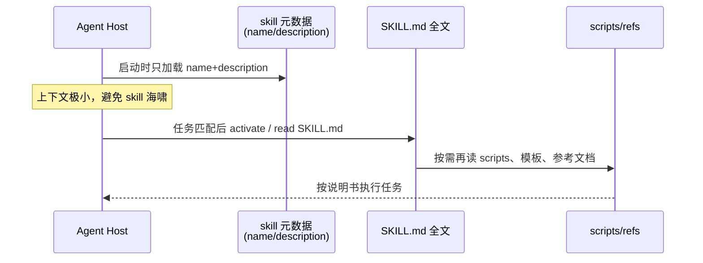
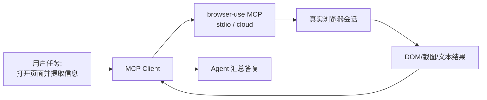
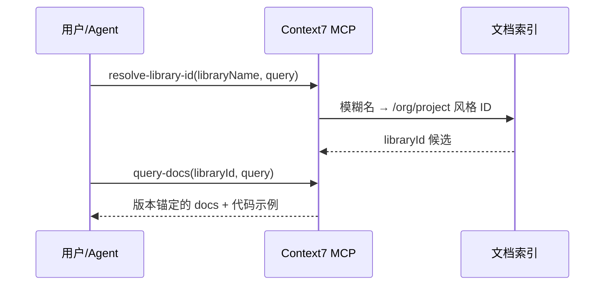

# 开源 AI Agent Skills / MCP 周报 · 第 4 期（2026-W47）

> **周期**：2026-11-15 → 2026-11-21（ISO 周次 W47）  
> **时区**：Asia/Shanghai（UTC+8）  
> **调研日**：2026-11-16  
> **范围**：完全开源、可二次开发（优先 MIT / Apache-2.0 / BSD）；覆盖 Agent Skills 标准与生态、Skills↔MCP 桥接、热门 MCP Server  
> **Star 来源**：cursor-github `get_repository` / `search_repositories`（连接账户 gaojiang818）于 **2026-11-16** 拉取；文中标注为「已核实」。  
> **相对上期**：对比 [`reports/2026-W45-open-source-skills.md`](./2026-W45-open-source-skills.md)（调研日 2026-11-02）已核实 Stars。  
> **出刊说明**：原定 2026-11-09 的 **W46（第 4 期）例程未能出刊**，本期接续为第 4 期、跳过空窗编号；故 Δ 为约 **14 日**短窗，不作 7 日趋势外推。

---

## 本期速览

| 信号 | 内容 |
|------|------|
| 相对 W45 | 主榜 **12 名次未变**；合计约 **+19,178 stars**（约 14 日短窗）。`anthropics/skills`（**+9,002**）领涨；`NVIDIA/SkillSpector`（**+2,374**）与 `ChromeDevTools/chrome-devtools-mcp`（**+2,326**）次之 |
| 标准层 | **Agent Skills 规范仓捐赠 AAIF / LF Projects**：`agentskills/agentskills` 于 **2026-11-05** 合入治理与维护者文件（`GOVERNANCE.md` 载明 Adopted November 4, 2026），项目将作为 **Agent Skills a Series of LF Projects, LLC** 运作；代码与规范出站 **Apache-2.0**，文档（不含规范）**CC-BY-4.0** |
| 许可变化 | `anthropics/skills` 的文档类 skill（docx/pdf/pptx/xlsx）已于 **2026-11-07** 由 source-available **改为 Apache-2.0**（PR #2146）；已核对这些目录下 `LICENSE.txt` 均为 Apache License 2.0 全文。**仓库根目录仍无统一 SPDX**，二次开发请继续分目录核对 |
| 活跃推送（W45 调研日之后） | `agentskills/agentskills`（AAIF 治理）、`anthropics/skills`（Office skill 开源 + 内容更新）、`microsoft/playwright-mcp`（**v0.0.85**）、`ChromeDevTools/chrome-devtools-mcp`（**v1.13.0**）、`github/github-mcp-server`（**v2.1.0**，随后主分支合入 MCP skills 协议）、`yamadashy/repomix`（**v1.19.0**，MCP 迁到 TS SDK v2）、`NVIDIA/SkillSpector`（**v2.13.4** 及后续修复）、`browser-use/browser-use`（**1.0.6**，默认模型改为 BU 4.0）、`upstash/context7`、`modelcontextprotocol/servers`（v2.4.0 及相关安全修复）等 |
| 新晋入主榜？ | **无**。检索仍大量涌入高星单仓 Skill / Agent harness / 垂直 skill 包；另：`kepano/obsidian-skills` 已转到官方组织 **`obsidianmd/obsidian-skills`**（**52,824**），仍属垂直 skill 包，不入主榜。`oraios/serena`（**31,413**）星数已超过主榜 #12，但许可为 **分组件混合（SolidLSP MIT + 应用 GPL-3.0-or-later）**、GitHub SPDX 仍为 NOASSERTION，按口径暂不入榜 |
| 二次开发注意 | 仓库级无 SPDX 的情况未变（`anthropics/skills`、`modelcontextprotocol/servers`）；Serena 组合分发实质走 GPL-3.0-or-later；文档类 skill 现已可按 Apache-2.0 二次开发（以目录内 LICENSE 为准） |

### 相对 W45 · Stars 差异表（已核实）

| 项目 | W45 | W47 | Δ |
|------|-----|-----|---|
| anthropics/skills | 186,370 | **195,372** | +9,002 |
| browser-use/browser-use | 119,772 | **121,114** | +1,342 |
| punkpeye/awesome-mcp-servers | 97,175 | **97,741** | +566 |
| modelcontextprotocol/servers | 91,738 | **92,021** | +283 |
| upstash/context7 | 64,051 | **64,877** | +826 |
| ChromeDevTools/chrome-devtools-mcp | 54,624 | **56,950** | +2,326 |
| DeusData/codebase-memory-mcp | 47,956 | **48,689** | +733 |
| microsoft/playwright-mcp | 38,951 | **39,692** | +741 |
| github/github-mcp-server | 34,143 | **34,496** | +353 |
| yamadashy/repomix | 29,111 | **29,278** | +167 |
| agentskills/agentskills | 26,851 | **27,316** | +465 |
| NVIDIA/SkillSpector | 23,867 | **26,241** | +2,374 |

> 说明：W45→W47 调研间隔约 14 天（中间 W46 未出刊）；Δ 为短窗变化，不作趋势外推。主榜连续性优先：本周仍无「基础设施级」新晋达到入榜标准。

---

## 精选清单（按已核实 Stars 降序，共 12）

### 1. anthropics/skills

| 字段 | 内容 |
|------|------|
| **一句话** | Anthropic 官方示范 Agent Skills 合集（`SKILL.md` + 脚本/资源），是学习 Skills 形态的第一站 |
| **Stars** | **195,372**（已核实） |
| **许可证** | **仓库级无统一 SPDX**（根目录仍无 `LICENSE`）；各 skill 目录多为 **Apache-2.0**。**变化**：docx/pdf/pptx/xlsx 已于 **2026-11-07** 改为 **Apache-2.0**（PR [#2146](https://github.com/anthropics/skills/pull/2146)，已核目录内 `LICENSE.txt`）——上期「文档类 skill 不可当开源二次开发」的警告**本期撤销**，但仍建议分目录核对 LICENSE |
| **最新更新亮点** | 最近推送约 **2026-11-15 05:52 Asia/Shanghai**。本窗口：2026-11-07 将 Office skill 改为 Apache-2.0；2026-11-14 再更新 docx/pptx/xlsx/pdf 内容（PR [#2217](https://github.com/anthropics/skills/pull/2217)）。短窗星数 **+9,002** |
| **仓库** | https://github.com/anthropics/skills |

### 2. browser-use/browser-use

| 字段 | 内容 |
|------|------|
| **一句话** | 开源 Python AI 浏览器 Agent 库，并提供本地 stdio MCP（`browser-use --mcp`）与云端 MCP 端点 |
| **Stars** | **121,114**（已核实） |
| **许可证** | **MIT** |
| **最新更新亮点** | 最近推送约 **2026-11-16 08:53 Asia/Shanghai**（调研当日仍在推送）；可见 **1.0.6**，并将默认模型改为 **BU 4.0** |
| **仓库** | https://github.com/browser-use/browser-use |

### 3. punkpeye/awesome-mcp-servers

| 字段 | 内容 |
|------|------|
| **一句话** | 社区最大 MCP Server 精选目录（按类别收录），二次开发前的「选型索引」 |
| **Stars** | **97,741**（已核实） |
| **许可证** | **MIT** |
| **最新更新亮点** | 最近推送约 **2026-11-07 01:59 Asia/Shanghai**；本窗口继续收录社区 Server（如 NeuroCode、markindex 等） |
| **仓库** | https://github.com/punkpeye/awesome-mcp-servers |

### 4. modelcontextprotocol/servers

| 字段 | 内容 |
|------|------|
| **一句话** | MCP 官方参考 Server 合集（文件系统、Git、记忆、顺序思考等参考实现） |
| **Stars** | **92,021**（已核实） |
| **许可证** | GitHub 显示 **NOASSERTION**；文档称**新贡献 Apache-2.0**，存量部分仍为 **MIT**——分目录核对 LICENSE |
| **最新更新亮点** | 最近推送约 **2026-11-12 13:37 Asia/Shanghai**；约 **2026-11-11** 合并 **v2.4.0** 及安全相关修复 PR（公开讨论含 GHSA-p9cv-8g75-4xcg、GHSA-3rxj-6jhw-qfv7 等，细节以 advisories 为准） |
| **仓库** | https://github.com/modelcontextprotocol/servers |

### 5. upstash/context7

| 字段 | 内容 |
|------|------|
| **一句话** | 为编码 Agent 拉取**版本锚定**的库文档与示例；同时支持 **MCP** 与 **CLI + Skills** 两种接入 |
| **Stars** | **64,877**（已核实） |
| **许可证** | **MIT**（注意：本仓库主要是 MCP/CLI 客户端侧；爬取与后端为私有） |
| **最新更新亮点** | 最近推送约 **2026-11-16 06:07 Asia/Shanghai**；可见 `@upstash/context7-tools-ai-sdk@1.0.4`（约 **2026-11-12 17:03 Asia/Shanghai**）：`resolveLibraryId` / `queryDocs` 无匹配时的返回文案收敛；并补充 on-prem SSO / 源码索引等文档 |
| **仓库** | https://github.com/upstash/context7 |

### 6. ChromeDevTools/chrome-devtools-mcp

| 字段 | 内容 |
|------|------|
| **一句话** | 官方 Chrome DevTools MCP：让 Agent 控制/检视真实 Chrome（调试、性能、自动化） |
| **Stars** | **56,950**（已核实） |
| **许可证** | **Apache-2.0** |
| **最新更新亮点** | 最新发布 **v1.13.0**（约 **2026-11-11 20:40 Asia/Shanghai**）：logpoints（基于 DevTools BreakpointManager）、页面范围的 network mocks、上游 mock 响应等。仓库最近推送约 **2026-11-15 11:06 Asia/Shanghai**（发布后还合入 `get_css_styles` 内联解析 CSS 自定义变量、工具运行期间收集页面错误等）。短窗星数 **+2,326** |
| **仓库** | https://github.com/ChromeDevTools/chrome-devtools-mcp |

### 7. DeusData/codebase-memory-mcp

| 字段 | 内容 |
|------|------|
| **一句话** | 本地代码智能图：把代码/文档/基础设施连成持久图，经 MCP 暴露给 Agent，并支持变更感知测试选择 |
| **Stars** | **48,689**（已核实） |
| **许可证** | **MIT** |
| **最新更新亮点** | 最近推送约 **2026-11-15 06:03 Asia/Shanghai**；持续迭代（请求取消、pkgmap 候选顺序、CI 等） |
| **仓库** | https://github.com/DeusData/codebase-memory-mcp |

### 8. microsoft/playwright-mcp

| 字段 | 内容 |
|------|------|
| **一句话** | Microsoft 官方 Playwright MCP：浏览器导航、点击、填表、截图等——社区高频「默认安装」之一 |
| **Stars** | **39,692**（已核实） |
| **许可证** | **Apache-2.0** |
| **最新更新亮点** | 最新发布 **v0.0.85**（约 **2026-11-10 02:28 Asia/Shanghai**）：扩展连接时可用 `--background`（配置 `background: true`，或环境变量 `PLAYWRIGHT_MCP_BACKGROUND=1`）避免抢占前台窗口，需扩展 **0.5.0+**。仓库最近推送约 **2026-11-16 04:56 Asia/Shanghai** |
| **仓库** | https://github.com/microsoft/playwright-mcp |

### 9. github/github-mcp-server

| 字段 | 内容 |
|------|------|
| **一句话** | GitHub 官方 MCP：Issues / PRs / Actions / 代码搜索等仓库操作一站接入 Agent |
| **Stars** | **34,496**（已核实） |
| **许可证** | **MIT** |
| **最新更新亮点** | 最新发布 **v2.1.0**（约 **2026-11-03 19:11 Asia/Shanghai**）。之后主分支于约 **2026-11-13 20:57 Asia/Shanghai** 合入 **MCP skills 协议**（PR [#3685](https://github.com/github/github-mcp-server/pull/3685)）：用经过工具过滤的 MCP skills 替换原先 server instructions，可显式或经 insiders 启用；该提交**尚未打入** v2.1.0 tag。仓库最近推送约 **2026-11-16 09:05 Asia/Shanghai** |
| **仓库** | https://github.com/github/github-mcp-server |

### 10. yamadashy/repomix

| 字段 | 内容 |
|------|------|
| **一句话** | 把整个仓库打包成 AI 友好的单文件/结构化上下文，并支持 `repomix --mcp`（可加 `--sandbox`） |
| **Stars** | **29,278**（已核实） |
| **许可证** | **MIT** |
| **最新更新亮点** | 最新发布 **v1.19.0**（约 **2026-11-08 11:04 Asia/Shanghai**）：MCP Server 迁到 **TypeScript SDK v2**，并按 2026-07-28 协议协商；支持 live progress 与 cancellation，`--compress` 更准确。仓库最近推送约 **2026-11-15 14:16 Asia/Shanghai** |
| **仓库** | https://github.com/yamadashy/repomix |

### 11. agentskills/agentskills

| 字段 | 内容 |
|------|------|
| **一句话** | **Agent Skills 开放标准**（规范 + 文档）：`SKILL.md` 格式、渐进披露、跨产品互操作的「规范源」 |
| **Stars** | **27,316**（已核实） |
| **许可证** | **Apache-2.0**（代码与规范）；文档 **CC-BY-4.0**（不含规范） |
| **最新更新亮点** | 最近推送约 **2026-11-05 03:47 Asia/Shanghai**。本窗口最大变化：合入 **AAIF Donation** 治理与维护者文件，以及站点页脚的 LF Projects 法律声明（PR #648 / #649）。这是规范从「社区仓」走向 **LF Projects 系列项目** 的关键一步 |
| **仓库** | https://github.com/agentskills/agentskills · 站点 https://agentskills.io |

### 12. NVIDIA/SkillSpector

| 字段 | 内容 |
|------|------|
| **一句话** | Agent Skills 安全扫描器：安装前检测恶意模式、提示注入、数据外泄与供应链风险（支持 Claude Code / Codex / MCP skills） |
| **Stars** | **26,241**（已核实） |
| **许可证** | **Apache-2.0** |
| **最新更新亮点** | 最新发布 **v2.13.4**（约 **2026-11-05 06:40 Asia/Shanghai**，维护版，含提供商兼容与畸形响应恢复等）。仓库最近推送约 **2026-11-14 12:49 Asia/Shanghai**：发布后仍有修复（Windows `--exclude` 通配符按字面保留、gateway 拒 `json_schema` 时回退、MiniMax 区域支持等）。短窗星数 **+2,374** |
| **仓库** | https://github.com/NVIDIA/SkillSpector · 文档 https://docs.nvidia.com/skills/scanning-agent-skills |

#### 附：同赛道小而美 / 桥接 / 本周关注（未进主榜）

| 项目 | Stars（已核实） | 许可证 | 备注 | 链接 |
|------|----------------|--------|------|------|
| obsidianmd/obsidian-skills（原 kepano/obsidian-skills） | 52,824 | MIT | 已转到 **Obsidian 官方组织**；仍为垂直 skill 包，不入主榜；Δ≈+2,245 | https://github.com/obsidianmd/obsidian-skills |
| VoltAgent/awesome-agent-skills | 37,215 | MIT | Skills 侧精选目录（官方+社区），对标 MCP 侧的 awesome-mcp-servers；本期新列入附录 | https://github.com/VoltAgent/awesome-agent-skills |
| oraios/serena | 31,413 | 分组件：SolidLSP **MIT**，应用 **GPL-3.0-or-later**（组合分发走 GPL；GitHub SPDX=NOASSERTION） | 编码 Agent 的语义检索/编辑 MCP；星数已超主榜 #12，因许可不单一、且应用侧为 GPL，暂不入榜 | https://github.com/oraios/serena |
| yusufkaraaslan/Skill_Seekers | 15,322 | MIT | 文档站/GitHub/PDF → Claude Skill；含 MCP；Δ≈+59；最近推送仍为 2026-09-30，偏静 | https://github.com/yusufkaraaslan/Skill_Seekers |
| mcp-use/mcp-use | 10,977 | MIT | 全栈 MCP 框架（Apps / Servers / Client）；Δ≈+140 | https://github.com/mcp-use/mcp-use |
| mobile-next/mobile-mcp | 10,594 | Apache-2.0 | 移动端（iOS/Android）MCP；Δ≈+392 | https://github.com/mobile-next/mobile-mcp |
| Ryze-AI-Adgent/open-seo-mcp-skills | 9,997 | MIT | SEO MCP + Skills（垂直场景）；短窗 **+1,441**，最近推送仍约 2026-10-27 | https://github.com/Ryze-AI-Adgent/open-seo-mcp-skills |
| awslabs/mcp | 9,928 | Apache-2.0 | AWS 官方开源 MCP Servers 合集；本窗口 AgentCore Server 增加 `web_search` 工具 | https://github.com/awslabs/mcp |
| firecrawl/firecrawl-mcp-server | 7,833 | MIT | Firecrawl 官方爬取/搜索 MCP | https://github.com/firecrawl/firecrawl-mcp-server |
| BrowserMCP/mcp | 7,362 | Apache-2.0 | 控制本机浏览器的 MCP | https://github.com/BrowserMCP/mcp |
| QianjieTech/Open-ClaudeSkill | 46 | Apache-2.0 | Skills→任意 MCP Client；最近推送停留在 2025-11，偏静 | https://github.com/QianjieTech/Open-ClaudeSkill |
| aviddiviner/skillsmcp | 27 | MIT | Skills MCP 暴露；最近推送约 2026-04-08，偏静 | https://github.com/aviddiviner/skillsmcp |
| olaservo/skilljack-mcp | 22 | MIT | Skills↔MCP 桥；约 **2026-11-08** 升至 **0.15.2**；最近推送约 **2026-11-15 07:43 Asia/Shanghai** | https://github.com/olaservo/skilljack-mcp |
| sohutv/agent-skills-mcp | 11 | Apache-2.0 | 规范对齐的 Skills MCP；仍偏静 | https://github.com/sohutv/agent-skills-mcp |

> **星数异常备忘（已核实但不入榜）**：本周检索仍可见大量高星单仓 Skill / harness / 垂直包，例如 `thedotmack/claude-mem`（**117,382**，Apache-2.0）、`paperclipai/paperclip`（**114,149**，MIT）、`tt-a1i/archify`（**96,811**，Apache-2.0）、`Egonex-AI/Understand-Anything`（**92,738**，MIT），以及营销/科学/设计等垂直 skill 合集。它们超出本刊「基础设施 / 标准 / MCP Server / Skills↔MCP 桥接」主榜口径；部分增长曲线仍需警惕刷星。后续仅当其沉淀为清晰的 Skills 标准基建 / MCP 桥 / 官方级 Server 时再评估。

> 检索备忘：`topic:claude-skills` / `topic:agent-skills` 与宽泛关键词会混入垂直 skill 商店、营销 skill 包与 awesome 列表；本刊只保留可二次开发的 Skills/MCP 相关仓，并逐仓 `get_repository` 核实 Stars 与许可证。

---

## Top 3 Demo 说明

> 对应榜单 **#1 / #2 / #5**（#3/#4 为目录/合集，交互 demo 价值较低；改用同属「单仓产品」且热度极高的 Context7）。  
> Top3 与 W45 相同，故**更新既有静态页 footer 为 W47**并微调星数文案：`demos/demo-01-agent-skills.html`、`demo-02-browser-use.html`、`demo-03-context7.html`。

### Demo 1 — Agent Skills 渐进披露（对应 #1 anthropics/skills / 规范 #11）

**核心流程（Mermaid）**



**二次开发要点**：实现「目录扫描 → 元数据索引 → 按需读全文」三层即可兼容 Claude Code / Cursor 等；不要在 initialize 时把所有 `SKILL.md` 塞进 system prompt。安装第三方 skill 前可先过 SkillSpector 一类扫描。规范侧请跟踪 AAIF / LF Projects 治理落地。文档类 Office skill 现已是 Apache-2.0，仍以目录内 `LICENSE.txt` 为准。

### Demo 2 — browser-use MCP（对应 #2）

**核心流程**



**二次开发要点**：本地用 `uvx --from 'browser-use[cli]' browser-use --mcp`；云端走带 API Key 的 HTTP MCP。MCP 负责「手」，Skills 可另附「怎么测登录流」等规程。同赛道可对照 Playwright MCP **v0.0.85** 的 `--background`（扩展连接时不抢前台），以及 Chrome DevTools MCP **v1.13.0** 的 logpoints / network mocks。

### Demo 3 — Context7 文档注入（对应 #5）

**核心流程**



**二次开发要点**：先 `resolve-library-id` 再 `query-docs`；可与 Agent Skill（「写 Next.js 时必须先查 Context7」）组合，减少幻觉 API。近期 SDK 对「库/文档未找到」的返回文案更明确；配置里未展开的 `${CONTEXT7_API_KEY}` 仍会被当作无 Key。

---

## 二次开发速查

| 目标 | 建议起点 | 许可证友好度 |
|------|----------|--------------|
| 实现 / 扩展 Skills 规范 | `agentskills/agentskills`（现为 AAIF / LF Projects 系列项目） | Apache-2.0 ✅ |
| 抄示范 skill（含文档编辑类） | `anthropics/skills` 各目录（Office skill 已改 Apache-2.0） | 分目录核对 ⚠️（根目录仍无 SPDX） |
| 写 MCP Server（TS） | `anthropics/skills` 的 `mcp-builder`（含 SDK v2 指南）+ 官方 servers；实践参考 `repomix` v1.19.0 已迁 SDK v2 | 分目录核对 ⚠️ |
| 安装前扫描第三方 skill | `NVIDIA/SkillSpector` | Apache-2.0 ✅ |
| 文档→Skill 生成 | `Skill_Seekers` | MIT ✅ |
| Skills → 任意 MCP Client | `skilljack-mcp` / `Open-ClaudeSkill` / `skillsmcp` | MIT / Apache ✅ |
| 编码 Agent 默认三件套 | Context7 + GitHub MCP + Playwright MCP | MIT / MIT / Apache ✅ |
| 浏览器 Agent | browser-use 或 Playwright MCP（v0.0.85 起注意 `--background`） | MIT / Apache ✅ |
| 仓库级上下文打包 | repomix `--mcp`（v1.19.0 起 SDK v2） | MIT ✅ |
| 云厂商 MCP 起步 | `awslabs/mcp` | Apache-2.0 ✅ |
| Skills 选型索引 | `VoltAgent/awesome-agent-skills` | MIT ✅ |

### 最小 MCP 配置示例（示意）

```json
{
  "mcpServers": {
    "context7": {
      "command": "npx",
      "args": ["-y", "@upstash/context7-mcp"],
      "env": { "CONTEXT7_API_KEY": "YOUR_KEY_OR_OMIT" }
    },
    "github": {
      "command": "npx",
      "args": ["-y", "@modelcontextprotocol/server-github"],
      "env": { "GITHUB_PERSONAL_ACCESS_TOKEN": "YOUR_TOKEN" }
    },
    "playwright": {
      "command": "npx",
      "args": ["-y", "@playwright/mcp@0.0.85"]
    },
    "skilljack": {
      "command": "npx",
      "args": ["-y", "@skilljack/mcp", "/path/to/skills"]
    }
  }
}
```

---

## 数据与方法

1. **检索**：cursor-github `search_repositories`（`topic:claude-skills stars:>500`、`topic:agent-skills stars:>200`、`topic:mcp-server stars:>3000`，以及已知候选仓名）+ 对 W45 主榜/附录与候选仓逐一 `get_repository` 核实 `stargazers_count`、`license.spdx_id`、`pushed_at`；部分仓辅以 `get_latest_release` / `list_releases` / `list_commits` / `get_commit` / `get_file_contents`（例如核验 Office skill 的 `LICENSE.txt`、Serena 的分组件许可、agentskills 的 `GOVERNANCE.md`）。  
2. **本机 `gh`**：box 上 `gh` 未鉴权；调研走 MCP 鉴权账户（gaojiang818）。推送见仓库 commit。  
3. **时间**：API 的 `pushed_at` / `published_at` / commit 时间为 UTC，文中已换算为 **Asia/Shanghai**。  
4. **不做的事**：不伪造 star；不对未开源/混合许可部分做「可自由二次开发」承诺；不对疑似刷星的病毒式 Skill 包机械入榜。W46 未出刊，不补造 11-09 的星数快照。

---

## 下期预告

- 跟踪 Agent Skills 在 **AAIF / LF Projects** 治理下的维护者结构、规范修订节奏，以及各 SDK 对 MCP **Skills Extension（SEP-2640）** 的落地（GitHub MCP 主分支已出现 skills 协议，待正式发版）  
- `repomix` 等对 **MCP TS SDK v2** 的迁移是否带动更多 Server 跟进；对照 `mcp-builder` 指南  
- SkillSpector 规则与提供商兼容（v2.13.4 之后的修复）vs 桥接工具（Skilljack 0.15.x）组合用法  
- 继续观察 `awslabs/mcp`、`mcp-use`、`mobile-mcp`；`oraios/serena` 仅在许可表述更清晰、或主应用改为宽松许可后再评估入榜  
- 对病毒式 Skill 仓保持旁观：只记备忘，不进主榜，除非出现标准/协议层贡献

---

*第 4 期完 · 2026-W47*
