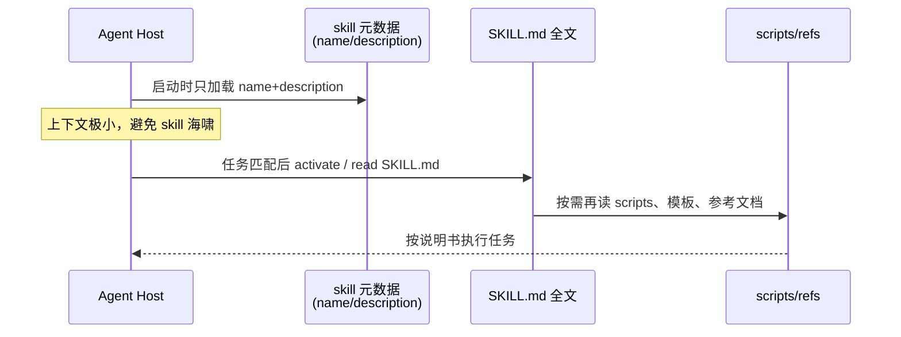
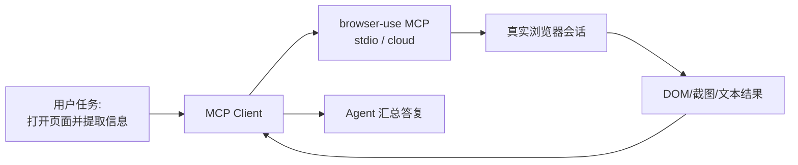
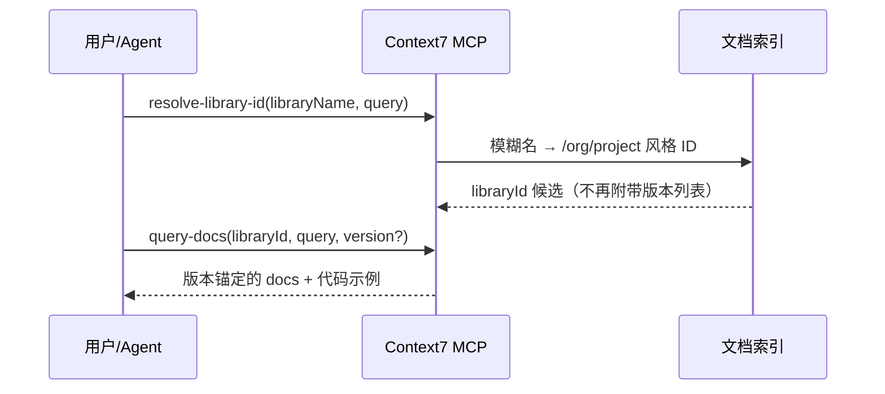

# 开源 AI Agent Skills / MCP 周报 · 第 5 期（2026-W48）

> **周期**：2026-11-22 → 2026-11-28（ISO 周次 W48）  
> **时区**：Asia/Shanghai（UTC+8）  
> **调研日**：2026-11-23  
> **范围**：完全开源、可二次开发（优先 MIT / Apache-2.0 / BSD）；覆盖 Agent Skills 标准与生态、Skills↔MCP 桥接、热门 MCP Server  
> **Star 来源**：cursor-github `get_repository` / `search_repositories`（连接账户 gaojiang818）于 **2026-11-23** 拉取；文中标注为「已核实」。  
> **相对上期**：对比 [`reports/2026-W47-open-source-skills.md`](./2026-W47-open-source-skills.md)（调研日 2026-11-16）已核实 Stars。  
> **出刊说明**：W45、W47 的 PR 仍未合入 main；本期从 W47 分支续写为第 5 期。Δ 为约 **7 日**短窗。

---

## 本期速览

| 信号 | 内容 |
|------|------|
| 相对 W47 | 主榜 **12 名次未变**；合计约 **+9,661 stars**（约 7 日短窗）。`anthropics/skills`（**+3,640**）领涨；`ChromeDevTools/chrome-devtools-mcp`（**+1,895**）与 `NVIDIA/SkillSpector`（**+1,065**）次之。SkillSpector 距规范仓 `agentskills/agentskills` 仅 **226** 星 |
| 标准 / 协议层 | **MCP Skills Extension 进入正式发版**：`github/github-mcp-server` **v2.2.0**（「The one with Skills」，约 **2026-11-17 07:30 Asia/Shanghai**）用过滤后的 MCP skills 替换 server instructions（PR [#3685](https://github.com/github/github-mcp-server/pull/3685)）。`upstash/context7` 亦于本窗口通过 PR [#3656](https://github.com/upstash/context7/pull/3656) **经 MCP skills extension 提供 context7-mcp skill**。规范仓 `agentskills/agentskills` 本窗口无新推送 |
| 安全 | 官方参考合集 `modelcontextprotocol/servers` 发布 **v2.5.0**（约 **2026-11-18 17:13 Asia/Shanghai**）：修复三个 Server 上的 **八个漏洞**。请将 `mcp-server-git` 升至 **2026.11.18**、`@modelcontextprotocol/server-filesystem` 升至 **2.4.0**、`@modelcontextprotocol/server-everything` 升至 **2.3.1**。日期版本的 filesystem 包需**显式**安装 2.4.0（semver 不会把 2.4.0 排在 2025.x/2026.x 之上） |
| 活跃推送（W47 调研日之后） | `github/github-mcp-server`（**v2.2.0**）、`modelcontextprotocol/servers`（**v2.5.0** 安全修复）、`microsoft/playwright-mcp`（**v0.0.86**，扩展连接可恢复标签组）、`browser-use/browser-use`（**1.0.8**）、`upstash/context7`（skills extension + 库版本独立入参）、`NVIDIA/SkillSpector`（**v2.13.5 / v2.13.6** 及后续 YARA / Registry API）、`ChromeDevTools/chrome-devtools-mcp`（v1.13.0 之后继续修配置与异常事件）、`yamadashy/repomix`、`punkpeye/awesome-mcp-servers`、`anthropics/skills`（Office skill 脚本修复）等 |
| 新晋入主榜？ | **无**。检索仍大量涌入高星单仓 Skill / Agent harness / 垂直 skill 包。`oraios/serena`（**31,614**）已超过主榜 #10–#12，许可口径不变，暂不入榜。`obsidianmd/obsidian-skills`（**53,457**，**1.2.1** 起可在 Grok Bot 加载）仍为垂直 skill 包 |
| 二次开发注意 | 仓库级无 SPDX 的情况未变（`anthropics/skills`、`modelcontextprotocol/servers`）；Serena 组合分发实质走 GPL-3.0-or-later。使用官方参考 Server 的请优先升级到 v2.5.0 对应包版本 |

### 相对 W47 · Stars 差异表（已核实）

| 项目 | W47 | W48 | Δ |
|------|-----|-----|---|
| anthropics/skills | 195,372 | **199,012** | +3,640 |
| browser-use/browser-use | 121,114 | **121,773** | +659 |
| punkpeye/awesome-mcp-servers | 97,741 | **98,396** | +655 |
| modelcontextprotocol/servers | 92,021 | **92,168** | +147 |
| upstash/context7 | 64,877 | **65,294** | +417 |
| ChromeDevTools/chrome-devtools-mcp | 56,950 | **58,845** | +1,895 |
| DeusData/codebase-memory-mcp | 48,689 | **49,044** | +355 |
| microsoft/playwright-mcp | 39,692 | **40,018** | +326 |
| github/github-mcp-server | 34,496 | **34,673** | +177 |
| yamadashy/repomix | 29,278 | **29,387** | +109 |
| agentskills/agentskills | 27,316 | **27,532** | +216 |
| NVIDIA/SkillSpector | 26,241 | **27,306** | +1,065 |

> 说明：W47→W48 调研间隔约 7 天；Δ 为短窗变化，不作趋势外推。主榜连续性优先：本周仍无「基础设施级」新晋达到入榜标准。Chrome DevTools MCP 与 Context7 的星差由上期约 7,927 收至约 **6,449**；SkillSpector 与规范仓仅差 **226**。

---

## 精选清单（按已核实 Stars 降序，共 12）

### 1. anthropics/skills

| 字段 | 内容 |
|------|------|
| **一句话** | Anthropic 官方示范 Agent Skills 合集（`SKILL.md` + 脚本/资源），是学习 Skills 形态的第一站 |
| **Stars** | **199,012**（已核实） |
| **许可证** | **仓库级无统一 SPDX**（根目录仍无 `LICENSE`）；各 skill 目录多为 **Apache-2.0**（含已改开源的 Office skill）。二次开发请继续分目录核对 LICENSE |
| **最新更新亮点** | 最近推送约 **2026-11-16 22:22 Asia/Shanghai**。本窗口：PR [#2221](https://github.com/anthropics/skills/pull/2221) 更新 docx/pptx/xlsx skill（zipfile 解包、`zip -y`、`validate.py` 与 `soffice.py` 修复）。短窗星数 **+3,640** |
| **仓库** | https://github.com/anthropics/skills |

### 2. browser-use/browser-use

| 字段 | 内容 |
|------|------|
| **一句话** | 开源 Python AI 浏览器 Agent 库，并提供本地 stdio MCP（`browser-use --mcp`）与云端 MCP 端点 |
| **Stars** | **121,773**（已核实） |
| **许可证** | **MIT** |
| **最新更新亮点** | 最新发布 **1.0.8**（约 **2026-11-22 11:30 Asia/Shanghai**，此前有 1.0.7 / 1.0.8rc1）：judge 改为在同一次 run 中再要一轮以便命中供应商缓存；SSH/无头环境可用链接+授权码完成登录，不必在会话里放 API Key；DeepSeek / Qwen thinking 模式在步数上限时不再强制最终调用；`bu.type` 不再打印密码框内容；`Browser(cdp_url=...)` 附着已打开页面而非新空白标签。仓库最近推送约 **2026-11-22 11:44 Asia/Shanghai** |
| **仓库** | https://github.com/browser-use/browser-use |

### 3. punkpeye/awesome-mcp-servers

| 字段 | 内容 |
|------|------|
| **一句话** | 社区最大 MCP Server 精选目录（按类别收录），二次开发前的「选型索引」 |
| **Stars** | **98,396**（已核实） |
| **许可证** | **MIT** |
| **最新更新亮点** | 最近推送约 **2026-11-23 09:12 Asia/Shanghai**（调研当日仍在合入）；本窗口继续收录社区 Server（如 Lathe DAW MCP、scrapecrate 等） |
| **仓库** | https://github.com/punkpeye/awesome-mcp-servers |

### 4. modelcontextprotocol/servers

| 字段 | 内容 |
|------|------|
| **一句话** | MCP 官方参考 Server 合集（文件系统、Git、记忆、顺序思考等参考实现） |
| **Stars** | **92,168**（已核实） |
| **许可证** | GitHub 显示 **NOASSERTION**；文档称**新贡献 Apache-2.0**，存量部分仍为 **MIT**——分目录核对 LICENSE |
| **最新更新亮点** | 最新发布 **v2.5.0**（约 **2026-11-18 17:13 Asia/Shanghai**）：修复三个 Server 上的八个漏洞（git：GHSA-h2g3-rwxm-xfm3、GHSA-87qg-cmw8-jc5m、GHSA-9vjp-x34c-xg6v、GHSA-pm7p-vphh-2cg7、GHSA-r2q8-f657-4r56、GHSA-8wv7-r664-7594；filesystem：GHSA-rq2p-q7c4-6g27；everything：GHSA-38j4-j742-j7r3）。发布说明还指出：Windows 上 directory listing 仍未锚定；git 在工作树写入后尚未重复 `--repository` 约束检查。仓库最近推送约 **2026-11-20 00:41 Asia/Shanghai** |
| **仓库** | https://github.com/modelcontextprotocol/servers |

### 5. upstash/context7

| 字段 | 内容 |
|------|------|
| **一句话** | 为编码 Agent 拉取**版本锚定**的库文档与示例；同时支持 **MCP** 与 **CLI + Skills** 两种接入 |
| **Stars** | **65,294**（已核实） |
| **许可证** | **MIT**（注意：本仓库主要是 MCP/CLI 客户端侧；爬取与后端为私有） |
| **最新更新亮点** | 仓库最近推送约 **2026-11-22 20:44 Asia/Shanghai**。本窗口可见：经 **MCP skills extension** 提供 context7-mcp skill（PR [#3656](https://github.com/upstash/context7/pull/3656)）；库版本改为独立入参，`resolve-library-id` 不再列出版本（PR [#3674](https://github.com/upstash/context7/pull/3674)）；文档补充实验性 MCP 工具关闭开关、代码搜索 503、Azure DevOps 企业集成等。包版本可见 `@upstash/context7-mcp@4.7.3` / `ctx7@0.12.2`（约 **2026-11-17 21:51 Asia/Shanghai**） |
| **仓库** | https://github.com/upstash/context7 |

### 6. ChromeDevTools/chrome-devtools-mcp

| 字段 | 内容 |
|------|------|
| **一句话** | 官方 Chrome DevTools MCP：让 Agent 控制/检视真实 Chrome（调试、性能、自动化） |
| **Stars** | **58,845**（已核实） |
| **许可证** | **Apache-2.0** |
| **最新更新亮点** | 最新正式版仍为 **v1.13.0**（上期已报）。本窗口未发新版，但主分支持续修复：拒绝超过两段的 `--viewport`、改用 exception events 而非 `Runtime.exceptionThrown`、负数字参数解析与 yargs-parser 对齐，以及把若干工具模块从 browser bundle 中拆出。仓库最近推送约 **2026-11-22 09:06 Asia/Shanghai**。短窗星数 **+1,895** |
| **仓库** | https://github.com/ChromeDevTools/chrome-devtools-mcp |

### 7. DeusData/codebase-memory-mcp

| 字段 | 内容 |
|------|------|
| **一句话** | 本地代码智能图：把代码/文档/基础设施连成持久图，经 MCP 暴露给 Agent，并支持变更感知测试选择 |
| **Stars** | **49,044**（已核实） |
| **许可证** | **MIT** |
| **最新更新亮点** | 最新正式版仍为 **v0.12.1**（2026-10）。本窗口持续迭代（空语义查询、LSP 引擎表作用域、discover/deploy 环境落地、C include 查找等）。仓库最近推送约 **2026-11-21 13:43 Asia/Shanghai** |
| **仓库** | https://github.com/DeusData/codebase-memory-mcp |

### 8. microsoft/playwright-mcp

| 字段 | 内容 |
|------|------|
| **一句话** | Microsoft 官方 Playwright MCP：浏览器导航、点击、填表、截图等——社区高频「默认安装」之一 |
| **Stars** | **40,018**（已核实） |
| **许可证** | **Apache-2.0** |
| **最新更新亮点** | 最新发布 **v0.0.86**（约 **2026-11-19 02:50 Asia/Shanghai**）：扩展连接页可一次选择整个标签组或若干标签；客户端断开后组仍保留（变灰），下次可恢复同一组；新的 **Manage clients** 页可断开客户端并轮换 token；可用 `--session-name` / `--session-color`（或 `PLAYWRIGHT_MCP_SESSION_NAME` / `PLAYWRIGHT_MCP_SESSION_COLOR`）区分同浏览器中的会话；Linux ARM64 可用 `npx @playwright/mcp@0.0.86 install-browser chrome` 安装稳定版 Chrome。需搭配更新后的 Playwright 浏览器扩展。仓库最近推送约 **2026-11-19 02:50 Asia/Shanghai** |
| **仓库** | https://github.com/microsoft/playwright-mcp |

### 9. github/github-mcp-server

| 字段 | 内容 |
|------|------|
| **一句话** | GitHub 官方 MCP：Issues / PRs / Actions / 代码搜索等仓库操作一站接入 Agent |
| **Stars** | **34,673**（已核实） |
| **许可证** | **MIT** |
| **最新更新亮点** | 最新发布 **v2.2.0**「The one with Skills」（约 **2026-11-17 07:30 Asia/Shanghai**）：用过滤后的 MCP skills 替换 server instructions（PR [#3685](https://github.com/github/github-mcp-server/pull/3685)），兑现上期「主分支已出现 skills 协议、待正式发版」的预告；另有可选的 secret scanning 告警脱敏，以及公开的 agent automation 工具。随后主分支还合入 Gemini plugin manifest（PR [#3910](https://github.com/github/github-mcp-server/pull/3910)）。仓库最近推送约 **2026-11-21 16:39 Asia/Shanghai** |
| **仓库** | https://github.com/github/github-mcp-server |

### 10. yamadashy/repomix

| 字段 | 内容 |
|------|------|
| **一句话** | 把整个仓库打包成对 LLM 友好的单个文件，并提供 `--mcp` 接入 |
| **Stars** | **29,387**（已核实） |
| **许可证** | **MIT** |
| **最新更新亮点** | 最新正式版仍为 **v1.19.0**（MCP 已迁 TS SDK v2，上期已报）。本窗口继续重构与修复：自研 XML 序列化替换 fast-xml-builder、安全检查 worker 扩缩、去掉 Handlebars 等。仓库最近推送约 **2026-11-23 06:35 Asia/Shanghai** |
| **仓库** | https://github.com/yamadashy/repomix |

### 11. agentskills/agentskills

| 字段 | 内容 |
|------|------|
| **一句话** | **Agent Skills 开放标准**（规范 + 文档）：`SKILL.md` 格式、渐进披露、跨产品互操作的「规范源」 |
| **Stars** | **27,532**（已核实） |
| **许可证** | **Apache-2.0**（代码与规范）；文档 **CC-BY-4.0**（不含规范） |
| **最新更新亮点** | 本窗口**无新提交**。最近推送仍约 **2026-11-05 03:47 Asia/Shanghai**（上期已报的 AAIF / LF Projects 治理落地）。规范本身未改，但周边实现（GitHub MCP、Context7）已开始按 MCP skills extension 出货 |
| **仓库** | https://github.com/agentskills/agentskills · 站点 https://agentskills.io |

### 12. NVIDIA/SkillSpector

| 字段 | 内容 |
|------|------|
| **一句话** | Agent Skills 安全扫描器：安装前检测恶意模式、提示注入、数据外泄与供应链风险（支持 Claude Code / Codex / MCP skills） |
| **Stars** | **27,306**（已核实） |
| **许可证** | **Apache-2.0** |
| **最新更新亮点** | 本窗口连续发布 **v2.13.5**（约 **2026-11-16 18:10 Asia/Shanghai**，加强有界解析与大 skill / 结构化输入覆盖）与 **v2.13.6**（约 **2026-11-17 05:16 Asia/Shanghai**，修复完整 JSON 元数据里裸 shell 包装名引发的误报）。发布后主分支继续合入：基线生成支持自定义 YARA 规则、对接官方 MCP Registry 稳定 API、扫描 Poetry/PDM/Hatch/uv 的 `pyproject.toml` 依赖表等。仓库最近推送约 **2026-11-23 02:53 Asia/Shanghai**。短窗星数 **+1,065** |
| **仓库** | https://github.com/NVIDIA/SkillSpector · 文档 https://docs.nvidia.com/skills/scanning-agent-skills |

#### 附：同赛道小而美 / 桥接 / 本周关注（未进主榜）

| 项目 | Stars（已核实） | 许可证 | 备注 | 链接 |
|------|----------------|--------|------|------|
| obsidianmd/obsidian-skills | 53,457 | MIT | 仍为垂直 skill 包，不入主榜；Δ=+633。**1.2.1**（约 **2026-11-21 03:22 Asia/Shanghai**）在 Cursor manifest 中声明 `skills/`，现可在 Grok Bot 加载 | https://github.com/obsidianmd/obsidian-skills |
| VoltAgent/awesome-agent-skills | 37,449 | MIT | Skills 侧精选目录；Δ=+234；最近推送仍约 2026-11-16 02:23 Asia/Shanghai（W47 窗口内，本期无更新） | https://github.com/VoltAgent/awesome-agent-skills |
| oraios/serena | 31,614 | 分组件：SolidLSP **MIT**，应用 **GPL-3.0-or-later**（组合分发走 GPL；GitHub SPDX=NOASSERTION） | 星数已超主榜 #10–#12；本窗口有仪表盘/Windows tray 等改动，最新正式版仍为 v2.1.0；许可口径不变，暂不入榜 | https://github.com/oraios/serena |
| yusufkaraaslan/Skill_Seekers | 15,358 | MIT | 文档站/GitHub/PDF → Claude Skill；Δ=+36。上期视为偏静，本窗口于约 **2026-11-16 20:58 Asia/Shanghai** 合入 PDF 抽取相关修复（#489–#491）；最新正式版仍为 v3.10.0（2026-09-30） | https://github.com/yusufkaraaslan/Skill_Seekers |
| mcp-use/mcp-use | 11,004 | MIT | 全栈 MCP 框架；Δ=+27；可见 **2.12.9**（约 2026-11-19 16:09 Asia/Shanghai），并有 2.12.10 canary | https://github.com/mcp-use/mcp-use |
| mobile-next/mobile-mcp | 10,806 | Apache-2.0 | 移动端 MCP；Δ=+212；最新 **1.0.19**（约 **2026-11-23 05:35 Asia/Shanghai**）：`mobile_launch_app` 可传启动参数与环境变量，并在列出远程设备时标注可用性 | https://github.com/mobile-next/mobile-mcp |
| Ryze-AI-Adgent/open-seo-mcp-skills | 10,644 | MIT | SEO MCP + Skills（垂直场景）；短窗 **+647**，但最近推送仍约 2026-10-27，星数增长与代码活跃度不同步，继续观察、不入主榜 | https://github.com/Ryze-AI-Adgent/open-seo-mcp-skills |
| awslabs/mcp | 9,940 | Apache-2.0 | AWS 官方开源 MCP Servers 合集；Δ=+12；本窗口持续发版（如 2026.11.20261119223057），含 document-loader 超时清理 soffice 进程树、README 增加 Strands Agents 客户端说明等 | https://github.com/awslabs/mcp |
| firecrawl/firecrawl-mcp-server | 7,883 | MIT | Firecrawl 官方爬取/搜索 MCP；Δ=+50；GitHub 最新 Release 仍为 v3.36.1，主分支继续迭代工具描述与 schema | https://github.com/firecrawl/firecrawl-mcp-server |
| BrowserMCP/mcp | 7,402 | Apache-2.0 | 控制本机浏览器的 MCP；Δ=+40；最近推送仍约 2026-11-13 00:35 Asia/Shanghai | https://github.com/BrowserMCP/mcp |
| QianjieTech/Open-ClaudeSkill | 46 | Apache-2.0 | Skills→任意 MCP Client；最近推送停留在 2025-11，偏静 | https://github.com/QianjieTech/Open-ClaudeSkill |
| aviddiviner/skillsmcp | 27 | MIT | Skills MCP 暴露；最近推送约 2026-04-08，偏静 | https://github.com/aviddiviner/skillsmcp |
| olaservo/skilljack-mcp | 22 | MIT | Skills↔MCP 桥；最新正式版仍为 **0.15.2**；仓库 `pushed_at` 约 **2026-11-22 07:42 Asia/Shanghai**，默认分支在本窗口未见新提交 | https://github.com/olaservo/skilljack-mcp |
| sohutv/agent-skills-mcp | 11 | Apache-2.0 | 规范对齐的 Skills MCP；仍偏静 | https://github.com/sohutv/agent-skills-mcp |

> **星数异常备忘（已核实但不入榜）**：本周检索仍可见大量高星单仓 Skill / harness / 垂直包，例如 `thedotmack/claude-mem`（**119,095**，Apache-2.0）、`paperclipai/paperclip`（**115,976**，MIT，open issues 约 7,021）、`tt-a1i/archify`（**98,800**，Apache-2.0）、`Egonex-AI/Understand-Anything`（**93,683**，MIT）。更宽泛的 `topic:agent-skills` 还出现星数异常偏高的条目（如 `morluto/rea` 约 47 万星等）。它们超出本刊「基础设施 / 标准 / MCP Server / Skills↔MCP 桥接」主榜口径；部分增长曲线与 issue 体量仍需警惕刷星。后续仅当其沉淀为清晰的 Skills 标准基建 / MCP 桥 / 官方级 Server 时再评估。

> 检索备忘：`topic:claude-skills` / `topic:agent-skills` 与宽泛关键词会混入垂直 skill 商店、营销 skill 包与 awesome 列表；本刊只保留可二次开发的 Skills/MCP 相关仓，并逐仓 `get_repository` 核实 Stars 与许可证。

---

## Top 3 Demo 说明

> 对应榜单 **#1 / #2 / #5**（#3/#4 为目录/合集，交互 demo 价值较低；改用同属「单仓产品」且热度极高的 Context7）。  
> Top3 与 W47 相同，故**更新既有静态页 footer 为 W48**并微调星数与版本文案：`demos/demo-01-agent-skills.html`、`demo-02-browser-use.html`、`demo-03-context7.html`。

### Demo 1 — Agent Skills 渐进披露（对应 #1 anthropics/skills / 规范 #11）

**核心流程（Mermaid）**



**二次开发要点**：实现「目录扫描 → 元数据索引 → 按需读全文」三层即可兼容 Claude Code / Cursor 等；不要在 initialize 时把所有 `SKILL.md` 塞进 system prompt。安装第三方 skill 前可先过 SkillSpector（现为 v2.13.6，并可跟官方 MCP Registry 稳定 API）。规范仓本周无新提交，但 GitHub MCP v2.2.0 与 Context7 已按 MCP skills extension 出货，可对照实现。Office skill 仍以目录内 `LICENSE.txt` 为准。

### Demo 2 — browser-use MCP（对应 #2）

**核心流程**



**二次开发要点**：本地用 `uvx --from 'browser-use[cli]' browser-use --mcp`；云端走带 API Key 的 HTTP MCP。MCP 负责「手」，Skills 可另附「怎么测登录流」等规程。本周可对照 browser-use **1.0.8**（无头/SSH 授权码登录、cached judge），以及 Playwright MCP **v0.0.86** 的标签组恢复 / `--session-name`。Chrome DevTools MCP 仍为 **v1.13.0**，主分支在修配置与异常事件。

### Demo 3 — Context7 文档注入（对应 #5）

**核心流程**



**二次开发要点**：先 `resolve-library-id` 再 `query-docs`；**库版本改为独立入参**，不要再指望 `resolve-library-id` 返回版本列表。本窗口还增加了经 MCP skills extension 下发的 context7-mcp skill，可与「写 Next.js 时必须先查 Context7」一类 Host skill 组合。配置里未展开的 `${CONTEXT7_API_KEY}` 仍会被当作无 Key；实验性工具需显式打开。

---

## 二次开发速查

| 目标 | 建议起点 | 许可证友好度 |
|------|----------|--------------|
| 实现 / 扩展 Skills 规范 | `agentskills/agentskills`（AAIF / LF Projects 系列项目；本周规范仓无新提交） | Apache-2.0 ✅ |
| 抄示范 skill（含文档编辑类） | `anthropics/skills` 各目录（Office skill 为 Apache-2.0，本周有脚本修复） | 分目录核对 ⚠️（根目录仍无 SPDX） |
| 写 MCP Server（TS） | `anthropics/skills` 的 `mcp-builder`（含 SDK v2 指南）+ 官方 servers；实践参考 `repomix` v1.19.0 已迁 SDK v2 | 分目录核对 ⚠️ |
| 安装前扫描第三方 skill | `NVIDIA/SkillSpector`（v2.13.6+；可跟官方 MCP Registry 稳定 API） | Apache-2.0 ✅ |
| 文档→Skill 生成 | `Skill_Seekers`（本窗口有 PDF 抽取修复） | MIT ✅ |
| Skills → 任意 MCP Client | `skilljack-mcp` / `Open-ClaudeSkill` / `skillsmcp`；亦可对照 GitHub MCP v2.2.0 与 Context7 的 skills extension 落地 | MIT / Apache ✅ |
| 编码 Agent 默认三件套 | Context7 + GitHub MCP（**v2.2.0**）+ Playwright MCP（**v0.0.86**） | MIT / MIT / Apache ✅ |
| 浏览器 Agent | browser-use **1.0.8** 或 Playwright MCP v0.0.86 | MIT / Apache ✅ |
| 仓库级上下文打包 | repomix `--mcp`（v1.19.0 起 SDK v2） | MIT ✅ |
| 官方参考 Server | 先升级到 **v2.5.0** 对应包版本（安全修复） | 分目录核对 ⚠️ |
| 云厂商 MCP 起步 | `awslabs/mcp` | Apache-2.0 ✅ |
| Skills 选型索引 | `VoltAgent/awesome-agent-skills` | MIT ✅ |

### 最小 MCP 配置示例（示意）

```json
{
  "mcpServers": {
    "context7": {
      "command": "npx",
      "args": ["-y", "@upstash/context7-mcp"],
      "env": { "CONTEXT7_API_KEY": "YOUR_KEY_OR_OMIT" }
    },
    "github": {
      "command": "npx",
      "args": ["-y", "@modelcontextprotocol/server-github"],
      "env": { "GITHUB_PERSONAL_ACCESS_TOKEN": "YOUR_TOKEN" }
    },
    "playwright": {
      "command": "npx",
      "args": ["-y", "@playwright/mcp@0.0.86"]
    },
    "skilljack": {
      "command": "npx",
      "args": ["-y", "@skilljack/mcp", "/path/to/skills"]
    }
  }
}
```

> 使用官方参考 Server（filesystem / git / everything）时，请按 v2.5.0 发布说明升级到已修复版本；日期版本的 filesystem 需显式安装 `@modelcontextprotocol/server-filesystem@2.4.0`。

---

## 数据与方法

1. **检索**：cursor-github `search_repositories`（`topic:claude-skills stars:>500`、`topic:agent-skills stars:>200`、`topic:mcp-server stars:>3000`，以及已知候选仓名）+ 对 W47 主榜/附录与候选仓逐一 `get_repository` 核实 `stargazers_count`、`license.spdx_id`、`pushed_at`；部分仓辅以 `get_latest_release` / `list_releases` / `list_commits`。  
2. **本机 `gh`**：box 上 `gh` 未鉴权；调研走 MCP 鉴权账户（gaojiang818）。推送见仓库 commit。  
3. **时间**：API 的 `pushed_at` / `published_at` / commit 时间为 UTC，文中已换算为 **Asia/Shanghai**。  
4. **不做的事**：不伪造 star；不对未开源/混合许可部分做「可自由二次开发」承诺；不对疑似刷星的病毒式 Skill 包机械入榜。不改写或关闭仍未合并的 W45 / W47 PR。

---

## 下期预告

- 继续跟踪 Agent Skills 在 **AAIF / LF Projects** 治理下的规范修订（本周规范仓无新提交），以及更多 Server 对 MCP **Skills Extension（SEP-2640）** 的发版（本周 GitHub MCP v2.2.0、Context7 已落地）  
- `repomix` 等对 **MCP TS SDK v2** 的迁移是否带动更多 Server 跟进；对照 `mcp-builder` 指南  
- SkillSpector 自定义 YARA 基线、官方 MCP Registry 稳定 API 与桥接工具（Skilljack 等）的组合用法  
- 观察 Chrome DevTools MCP 是否继续逼近 Context7、SkillSpector 是否越过规范仓星数；`oraios/serena` 仅在许可表述更清晰、或主应用改为宽松许可后再评估入榜  
- 对病毒式 Skill 仓保持旁观：只记备忘，不进主榜，除非出现标准/协议层贡献

---

*第 5 期完 · 2026-W48*
